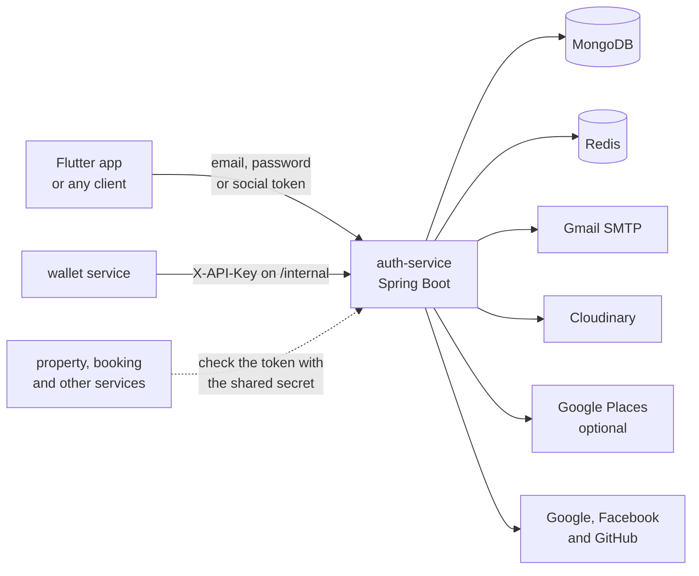

<div align="center">



<br/>

[](https://openjdk.org/projects/jdk/21/)
[](https://spring.io/projects/spring-boot)
[](docs/AUTHENTICATION.md)
[](https://www.mongodb.com)
[](https://redis.io)
[](docs/DEVELOPMENT.md)

[](docs/SOCIAL_SIGN_IN.md#google)
[](docs/SOCIAL_SIGN_IN.md#facebook)
[](docs/SOCIAL_SIGN_IN.md#github)
[](docs/CONFIGURATION.md#mail-and-profile-pictures)
[](docs/CONFIGURATION.md#mail-and-profile-pictures)
[](LICENSE)

[](https://github.com/peacemakerbill/premisave_auth_service/commits/main)
[](https://github.com/peacemakerbill/premisave_auth_service/stargazers)
[](https://github.com/peacemakerbill/premisave_auth_service/issues)
[](https://github.com/peacemakerbill/premisave_flutter_frontend)

**[Quick start](#quick-start)** &nbsp;|&nbsp; **[Docker and deploy](#run-it-with-docker-and-deploy-it)** &nbsp;|&nbsp; **[How it works](#how-it-works)** &nbsp;|&nbsp; **[Sign in](#sign-in-and-sessions)** &nbsp;|&nbsp; **[Access](#who-can-reach-what)** &nbsp;|&nbsp; **[Applications](#home-owner-applications)** &nbsp;|&nbsp; **[Docs](#documentation)**

</div>


## What is this?

The auth-service is the identity layer of the Premisave real estate platform. People sign up, sign in and manage their account here, and the other Premisave services (wallet, property, booking) trust the tokens it issues instead of running a login of their own.

It is a Spring Boot service with MongoDB for data and Redis for the token blacklist, the session cache and the sign-in throttles. The [Flutter app](https://github.com/peacemakerbill/premisave_flutter_frontend) is its main client, and any other client or service can use the same HTTP API.

| | |
| --- | --- |
| **Accounts** | Email and password with activation by email, password reset, and sign in with Google, Facebook or GitHub. |
| **Sessions you can see** | Every sign in is a server side session with two tokens. People can list their sessions and devices and end any of them. |
| **Alerts, not guesses** | A new device or an odd pattern sends an email with a "this was not me" link. Nothing is blocked automatically. |
| **Six roles** | Client, home owner, operations, finance, support and admin. Roles are only ever set on the server. |
| **Home Owner applications** | A client applies with documents, staff review it, and an admin promotes the account. Files stay on a disk you control. |
| **Profiles and social** | Profiles with pictures, likes, follows, reviews, profile views, location history and address search. |
| **A small internal API** | `/internal/**` lets other services check a user or a session with a shared key. |
| **One service to read** | 203 Java files, about 13 thousand lines, 118 endpoints. See [code at a glance](#code-at-a-glance). |


## Contents

- [Quick start](#quick-start)
- [Run it with Docker and deploy it](#run-it-with-docker-and-deploy-it)
- [How it works](#how-it-works)
- [Sign in and sessions](#sign-in-and-sessions)
- [Who can reach what](#who-can-reach-what)
- [Home Owner applications](#home-owner-applications)
- [Account security](#account-security)
- [API at a glance](#api-at-a-glance)
- [Where it sits](#where-it-sits)
- [Connected to the Flutter app](#connected-to-the-flutter-app)
- [Talking to other services](#talking-to-other-services)
- [Configuration](#configuration)
- [Project layout](#project-layout)
- [Everyday commands](#everyday-commands)
- [Documentation](#documentation)
- [Known gaps](#known-gaps)
- [Built with](#built-with)
- [Code at a glance](#code-at-a-glance)
- [Contributing](#contributing)
- [License and author](#license-and-author)


## Quick start


The full walk through, with every prerequisite and the things that usually go wrong, is in **[docs/SETUP.md](docs/SETUP.md)**. The short version:

**1. Install the tools.** Java 21 and git. For the databases, Docker is the quickest way, or install MongoDB and Redis yourself. (Want no Java at all? [Run everything in Docker](#run-it-with-docker-and-deploy-it).)

**2. Start the databases and get the code.**

```bash
docker run -d --name auth-mongo -p 27017:27017 mongo:8
docker run -d --name auth-redis -p 6379:6379 redis:7

git clone https://github.com/peacemakerbill/premisave_auth_service.git
cd premisave_auth_service
```

**3. Configure.** Copy the template and fill in the keys the service cannot start without. They have no defaults on purpose:

```bash
cp .env.example .env
```

| Key | What it is |
| --- | --- |
| `JWT_SECRET` | Signs every token. Create one with `openssl rand -base64 32`. Other services that accept these tokens need the same value. |
| `API_KEY` | The shared secret other services send as `X-API-Key`. Create one with `openssl rand -hex 32`. |
| `GMAIL_PASSWORD` | A Gmail App Password, used to send activation and alert emails. Set `GMAIL_USERNAME` to the address that sends them. |
| `CLOUDINARY_CLOUD_NAME`, `CLOUDINARY_API_KEY`, `CLOUDINARY_API_SECRET` | Profile pictures. A free account works. |

MongoDB and Redis default to `localhost`, so a local setup needs nothing else. Set `SECURITY_DEVICE_COOKIE_SECURE=false` while you are on plain `http`, or the browser will not keep the device cookie.

**4. Run it.**

```bash
sh ./mvnw spring-boot:run
```

**5. Check it.**

```bash
curl http://localhost:8080/health
```

**6. Sign in.** Register through the [Flutter app](https://github.com/peacemakerbill/premisave_flutter_frontend), through the [browser console](test-client/README.md) or with curl, then open the activation link in the email. To get an administrator on the first start, set `ADMIN1_*` or `INITIAL_ADMIN_EMAILS` as described in [docs/ADMIN_AND_ACCOUNT_SECURITY.md](docs/ADMIN_AND_ACCOUNT_SECURITY.md).

## Run it with Docker and deploy it

<p align="center">
  
</p>

Everything here uses **one Docker image**. What makes an environment development, staging or production is only the variables, above all `SPRING_PROFILES_ACTIVE` (`dev`, `staging` or `prod`). The image listens on `PORT` (or 8080), runs as an unprivileged user and reports its health at `GET /health`.

You do not need Java, Maven, MongoDB or Redis for this. You need **Docker with the Compose plugin**: `docker compose version` should print a version.

| I want to | Use | Go to |
| --- | --- | --- |
| Try it or work on it on my computer | `docker compose up --build` | [Development](#development-on-your-computer) |
| Run the auth-service, the messenger and the app together | three folders, in order | [The whole system](#the-whole-system-on-one-computer) |
| A test server for the team | `deploy/docker-compose.staging.yml` | [Staging](#staging-on-a-server) |
| The real thing | `deploy/docker-compose.production.yml` with a version tag | [Production](#production-on-a-server) |
| Render, Coolify, Fly.io, Railway or Heroku | the file in `deploy/` | [Hosting platforms](#hosting-platforms) |

### Development on your computer

<p align="center">
  
</p>

```bash
cd premisave_auth_service
docker compose up --build
```

Check it: `curl http://localhost:8080/health` answers `{"status":"UP"}`. Then register through the [Flutter app](https://github.com/peacemakerbill/premisave_flutter_frontend) or the [browser console](test-client/README.md).

Without a `.env` the service uses development defaults, so **email and profile pictures stay off**. Copy `.env.example` to `.env` next to `docker-compose.yml` and add the Gmail and Cloudinary values to try them. While you are on plain `http`, also set `SECURITY_DEVICE_COOKIE_SECURE=false`, or the browser drops the device cookie.

Useful commands, all run in the project folder:

| Command | What it does |
| --- | --- |
| `docker compose up --build` | Build the image and start everything. Add `-d` to run in the background |
| `docker compose logs -f` | Follow the log (add the service name `auth` to see only that one) |
| `docker compose ps` | Show what is running and whether it is healthy |
| `docker compose down` | Stop and remove the containers. **Your data stays** in its volumes |
| `docker compose down -v` | Same, and also delete the data. Use it for a clean start |
| `docker compose up --build -d auth` | Rebuild and restart only the service after a code change |

The first build takes a few minutes because Maven downloads the dependencies once. The next ones reuse them.

### The whole system on one computer

<p align="center">
  
</p>

Start them in this order, each in its own folder (the folders sit side by side):

```bash
(cd premisave_auth_service && docker compose up --build -d)                          # 1. sign in, on :8080
(cd premisave-messenger-service && docker compose up --build -d)                     # 2. messages, on :8081
(cd premisave-messenger-service/deploy/livekit && docker compose --env-file ../../.env up -d)   # 3. only for calls
(cd premisave_flutter_frontend && ./run.sh)                                          # 4. the app
```

The first time you want calls, make the key, the secret and the recordings folder, and have a Redis on port 6379, before step 3. Each step is in [Set up and run LiveKit](https://github.com/peacemakerbill/premisave-messenger-service#set-up-and-run-livekit) in the messenger README. Starting LiveKit does not change anything else: chat works with or without it.

To stop: `docker compose down` in each backend folder, and the same in `deploy/livekit` if you started it.

### Staging on a server

Staging is a copy of production that you can break. It gets its **own database and its own secrets**, and it pairs with the staging messenger and app, never the production one. The compose file starts MongoDB and Redis beside the service.

**1. Get the code and make the settings file.** The file is git-ignored, so secrets never reach GitHub.

```bash
git clone https://github.com/peacemakerbill/premisave_auth_service.git && cd premisave_auth_service

deploy/env/from-dotenv.sh staging        # builds deploy/env/staging.env from the example and your .env
```

The script copies every value your development `.env` already has and generates the secrets nobody could supply. It prints key names only, never values, and lists what you still have to check. Prefer to do it by hand? `cp deploy/env/staging.env.example deploy/env/staging.env` and open it in any editor.

These are the values that matter. Everything else has a default (see [`.env.example`](.env.example)).

| Value | What to put |
| --- | --- |
| `JWT_SECRET` | `openssl rand -base64 32`. The messenger must use the same one |
| `API_KEY` | `openssl rand -hex 32`. The messenger calls it `INTERNAL_API_KEY` |
| `FRONTEND_URL`, `BACKEND_URL` | Public addresses, used in the links inside emails |
| `OAUTH_ALLOWED_REDIRECT_URIS` | Where social sign in may send people back to |
| `GMAIL_USERNAME`, `GMAIL_PASSWORD` | The sender and its Gmail App Password |
| `CLOUDINARY_CLOUD_NAME`, `CLOUDINARY_API_KEY`, `CLOUDINARY_API_SECRET` | Profile pictures |
| `SECURITY_TRUSTED_PROXIES` | The address of your reverse proxy, so throttling sees the real caller |
| `INITIAL_ADMIN_EMAILS` | Who becomes an administrator on the first start |

**2. Start it.**

```bash
docker compose --env-file deploy/env/staging.env -f deploy/docker-compose.staging.yml up -d --build
```

**3. Check it.**

```bash
docker compose -f deploy/docker-compose.staging.yml ps
curl http://127.0.0.1:8080/health
docker compose -f deploy/docker-compose.staging.yml logs -f auth
```

**4. Update it later.** Pull the code and run step 2 again. **Stop it** with the same command ending in `down` instead of `up -d --build`.

The service is published on `127.0.0.1:8080` only, so nothing outside the server can reach it until you put a reverse proxy (nginx, Caddy or Traefik) in front for https. Set `HTTP_PORT` or `HTTP_BIND` in the env file to publish it elsewhere. Give the staging messenger the same `JWT_SECRET`, and your `API_KEY` as its `INTERNAL_API_KEY`. Home owner documents live in the `auth-data` volume: back it up.

### Production on a server

Production differs from staging in four ways, all on purpose:

- **MongoDB is not started here.** Use a managed database (MongoDB Atlas, with backups) and put its address in `MONGODB_URI`. Allow the server's address in Atlas.
- **The image is pulled by an exact version**, so production runs the very build you tested on staging. `IMAGE_TAG` is required.
- **Secrets have no fallback.** The file refuses to start without them.
- **Redis keeps its data on disk** and is reachable only from the service.

```bash
git clone https://github.com/peacemakerbill/premisave_auth_service.git && cd premisave_auth_service
deploy/env/from-dotenv.sh production                  # or copy deploy/env/production.env.example by hand and fill it in

docker login ghcr.io                                  # once. User: your GitHub name, password: a token with read:packages
IMAGE_TAG=1.0.0 docker compose --env-file deploy/env/production.env -f deploy/docker-compose.production.yml pull
IMAGE_TAG=1.0.0 docker compose --env-file deploy/env/production.env -f deploy/docker-compose.production.yml up -d
```

| Task | Command |
| --- | --- |
| Release a new version | `IMAGE_TAG=1.1.0 docker compose --env-file deploy/env/production.env -f deploy/docker-compose.production.yml pull`, then the same with `up -d` |
| Roll back | Run the two commands again with the previous `IMAGE_TAG` |
| See the log | `IMAGE_TAG=1.0.0 docker compose --env-file deploy/env/production.env -f deploy/docker-compose.production.yml logs -f --tail 200 auth` |
| Stop | `IMAGE_TAG=1.0.0 docker compose --env-file deploy/env/production.env -f deploy/docker-compose.production.yml down` (the data stays) |

### Publishing the image

<p align="center">
  
</p>

`.github/workflows/docker-image.yml` does it on GitHub, with nothing to set up:

| You push | Image tag published |
| --- | --- |
| branch `develop` | `development` |
| branch `staging` | `staging` |
| branch `main` | `production` and `latest` |
| tag `v1.2.3` | `1.2.3` |
| any of the above | also `sha-<commit>` |

A pull request only checks that the image builds. To cut a release: `git tag v1.0.0 && git push origin v1.0.0`, wait for the **Docker image** run to turn green in the Actions tab, then use `IMAGE_TAG=1.0.0` on the server. The first time, open the package on GitHub (your profile, Packages) and either make it public or let the repository read it.

### Hosting platforms

<p align="center">
  
</p>

Every platform runs the same Dockerfile. The files are in `deploy/`, except the two Heroku reads from the repository root.

| Platform | File | The one thing to set |
| --- | --- | --- |
| Docker Compose (a server) | `deploy/docker-compose.staging.yml`, `deploy/docker-compose.production.yml` | Run the commands above |
| Coolify | `deploy/docker-compose.coolify.yml` | Build pack **Docker Compose**, Base Directory `/deploy`, Compose Location `/docker-compose.coolify.yml` |
| Render | `deploy/render.yaml` | New, **Blueprint**, then set the file path to `deploy/render.yaml` in the Blueprint settings |
| Fly.io | `deploy/fly.staging.toml`, `deploy/fly.production.toml` | `fly deploy . --config deploy/fly.staging.toml --dockerfile Dockerfile` |
| Railway | `deploy/railway.json` | Service settings, **Config as code**, file path `/deploy/railway.json` |
| Heroku | `heroku.yml`, `app.json` (root) | `heroku create --stack container`, then push |

The steps for each one, the limits to know (Heroku has no file storage, Render cannot run LiveKit) and a troubleshooting table are in **[deploy/README.md](deploy/README.md)**.

### When Docker misbehaves

| You see | Why, and what to do |
| --- | --- |
| `open .../deploy/docker-compose.staging.yml: no such file` | You are not in the project folder, or you have not pulled the latest code. `cd` into it and `git pull` |
| `couldn't find env file .../deploy/env/staging.env` | The settings file does not exist yet. Run `deploy/env/from-dotenv.sh staging` |
| `required variable ... is missing a value` | Production insists on `IMAGE_TAG` and its secrets. Set them, or pass `IMAGE_TAG=1.0.0` in front of the command |
| `port is already allocated` or `address already in use` | Another stack uses 8080. `docker ps` shows which. Stop it, or set `HTTP_PORT` for staging and production |
| `pull access denied` or `unauthorized` from ghcr.io | Run `docker login ghcr.io`, make sure the package is readable, and check the tag exists (the Docker image run must have finished) |
| `Connection refused` to `localhost:27017` or `6379` | A value still points at `localhost`. Inside a container that is the container itself. Use the compose service names, or the real address |
| The container shows `unhealthy` for the first minute | Java is still starting. Allow about 90 seconds, then read `docker compose logs auth` |
| The build stops while downloading dependencies | A network hiccup. Run the same command again, the finished layers are cached |
| It stops at start with `Could not resolve placeholder 'JWT_SECRET'` | A required variable is missing. Fill it in the env file |
| Everyone looks like the same address and gets rate limited together | `SECURITY_TRUSTED_PROXIES` does not include your reverse proxy |
| Sign in works but the browser drops the cookie | The site is on `http`. Use https, or `SECURITY_DEVICE_COOKIE_SECURE=false` for development only |
| A document upload answers 503 | There is no writable `/data`. Mount a volume (see [docs/STORAGE.md](docs/STORAGE.md)) |


## How it works


Every request goes through the same path. Filters look at who is calling, the route rules decide whether that caller may go on, a controller checks the input and a service does the work against MongoDB and Redis. The counts in the picture are read from the source, see [code at a glance](#code-at-a-glance).



A few choices shape the rest of the code:

- **One place for identity.** Other services never store passwords. They check the token signature, read `userId` and `roles`, and can ask this service about a user or a session.
- **Email is the login.** The token subject is the email address. The display username is a separate field that can be changed.
- **Two trust boundaries.** People use tokens. Services use `X-API-Key`. The two never mix.
- **Sessions on the server.** Each sign in creates a session. That is what makes "sign out everywhere" and "end this device" real, and what lets a stolen refresh token be detected.
- **Roles are set on the server.** The signup form has no role field, and a role sent by a client is ignored.

The full tour is in **[docs/ARCHITECTURE.md](docs/ARCHITECTURE.md)**.


## Sign in and sessions


A sign in returns two tokens. The **access token** is sent on every request. The **refresh token** is sent only to `POST /auth/refresh`, and it works once: each refresh returns a new pair and raises the session generation, so an old refresh token no longer matches. If an old one is used again, the service treats it as theft, revokes the session and records a critical event.

```bash
# Sign in
curl -s -X POST http://localhost:8080/auth/signin \
  -H 'Content-Type: application/json' \
  -d '{"email":"you@example.com","password":"your password"}'
# {"token":"...","refreshToken":"...","role":"CLIENT","expiresIn":2592000}

# Call a protected route
curl -s http://localhost:8080/profile/me -H "Authorization: Bearer $TOKEN"

# Trade the refresh token for a new pair
curl -s -X POST http://localhost:8080/auth/refresh \
  -H 'Content-Type: application/json' -d "{\"refreshToken\":\"$REFRESH\"}"
```

By default an access token lasts about 30 days, which is long. Set `SECURITY_ACCESS_TOKEN_MINUTES` to a value between 15 and 60 once your clients use the refresh token, so a revoked session stops working everywhere within that time. The reasons and the details are in **[docs/AUTHENTICATION.md](docs/AUTHENTICATION.md)**.


## Who can reach what


The matrix is read from `SecurityConfig` and `ApiKeyFilter` by [`tool/readme_assets.py`](tool/readme_assets.py). The roles are `CLIENT`, `HOME_OWNER`, `ADMIN`, `OPERATIONS`, `FINANCE` and `SUPPORT`. Staff routes accept `ADMIN`, `OPERATIONS`, `FINANCE` and `SUPPORT`, and admin routes accept `ADMIN` only. Individual endpoints can add their own checks on top, such as asking for the password again before a device is trusted.


## Home Owner applications


A client who owns or manages property applies to become a home owner. They fill in a form and upload documents, staff review it, and an admin makes the final decision by promoting the account. Every step is emailed, every change is written to the application's timeline, and the files are kept on a disk you control, never in the database or in a third party service. The rules, the documents each owner type needs and the storage setup are in **[docs/HOME_OWNER_APPLICATIONS.md](docs/HOME_OWNER_APPLICATIONS.md)** and **[docs/STORAGE.md](docs/STORAGE.md)**.


## Account security


Beyond the password, the service keeps a record of devices and sessions and scores each sign in. A score at or above the threshold sends an email with a "this was not me" link. Opening the link changes nothing by itself: the app shows the report first, and only a button press ends the session and removes trust from the device.

- **Progressive throttling.** Repeated failures lock the account, and the lock grows, up to four hours. An address that fails too often or tries too many accounts is locked too. Locks expire on their own.
- **Step up.** Sensitive changes, such as trusting a device, ask for the password again. A fresh social sign in counts.
- **Audit trail.** Sign ins, failures, role changes, revocations and alerts are written to an event log that no endpoint can edit or delete.
- **Neutral signup.** One setting makes signup answer the same for a new and an existing email.
- **Administrators from configuration.** Up to three admins can be created at startup, and invitation links cover the rest. Nothing has a default password.

All of it, with the settings, is in **[docs/ADMIN_AND_ACCOUNT_SECURITY.md](docs/ADMIN_AND_ACCOUNT_SECURITY.md)**.


## API at a glance


Every error has the same JSON shape with `timestamp`, `status` and `message`, and validation errors add an `errors` map by field. The complete list of endpoints, with the body and the answer for each group, is in **[docs/API.md](docs/API.md)**. A Postman collection is in [`postman/`](postman), and the [browser console](test-client/README.md) exercises most of the API from a single page.


## Where it sits



The auth-service is where everyone signs in. It issues the token that the messenger, listing, wallet and property services check, and the Flutter app talks to it for accounts, sessions, profiles, security, the home owner application, administration and places.

| Caller | What for | Proves who it is with |
| --- | --- | --- |
| Flutter app | every sign in, profile, security and admin screen | the person's bearer token |
| messenger, listing, wallet, property | check the same token, and ask for profiles | `JWT_SECRET`, and `X-API-Key` for `/internal/**` |
| Browsers | the HTML test consoles under `test-client` | the person's bearer token |

It listens on port **8080**. The Flutter app finds it with the setting `BASE_URL`.


## Connected to the Flutter app



The Flutter app is this service's main client. Every screen that is not about messages, bookings, money, tenancy, developers or M-Pesa lookups uses it.

The code is in [`premisave_flutter_frontend`](https://github.com/peacemakerbill/premisave_flutter_frontend): the repository class is `lib/src/data/repositories/auth_repository.dart`, the providers are in `lib/src/state`, and every call below goes through one client built for this service.

### What the app does with it

| Screen | What it does | Calls |
| --- | --- | --- |
| Sign in and up | Email and password, activation, password reset, admin invitations | `/auth/signup`, `/auth/signin`, `/auth/logout`, `/auth/refresh`, `/auth/resend-activation`, `/auth/forgot-password`, `/auth/reset-password`, `/auth/change-password`, `/auth/admin-invitation/accept` |
| Social sign in | Google, Facebook and GitHub | `/auth/google`, `/auth/facebook`, `/auth/github` |
| Profile and location | Details, photo, who viewed me, location with a map picker | `/profile/me`, `/profile/update`, `/profile/upload-profile-picture`, `/profile/change-password`, `/profile/search`, `/profile/all`, `/profile/views/*`, `/location`, `/location/current`, `/location/history` |
| People | Follow, like and review | `/social/follow`, `/social/like`, `/social/review`, `/social/my-followers`, `/social/my-following`, `/social/my-likes`, `/social/my-reviews` |
| Security centre | Sessions, devices, sign in history, events, "this was not me" | `/security/sessions`, `/security/sessions/revoke-others`, `/security/devices`, `/security/events`, `/security/sign-ins`, `/auth/security-actions/inspect`, `/auth/security-actions/confirm` |
| Home owner application | The guided form, status, withdraw and reapply | `/home-owner/applications`, `/home-owner/applications/mine`, `/home-owner/applications/eligibility`, `/home-owner/applications/meta` |
| Staff review | The queue and the decisions | `/staff/applications`, `/staff/applications/stats`, `/staff/applications/reviewers` |
| Administration | Users, roles, platform security summary and audit trail | `/admin/users`, `/admin/users/active`, `/admin/users/archived`, `/admin/users/create`, `/admin/users/search`, `/admin/security/events`, `/admin/security/summary` |
| Places | Address search and "what is here" | `/places/suggest`, `/places/details`, `/places/reverse`, `/places/status` |
| Contact | The help screen form | `/contact` |

- The app is the only client that sends `X-Client-Platform` and `X-Device-Token`, so the auth-service can tell devices apart. The other services never receive them.
- Refresh tokens rotate: each works once and the answer carries the next. The app lets only one refresh run at a time so two screens cannot spend the same token.
- Answers are plain bodies, not an envelope.

### Settings

In the Flutter app, in `config/env/*.json` or passed with `--dart-define`:

| Key | Default | Meaning |
| --- | --- | --- |
| `BASE_URL` | `http://localhost:8080`, or `http://10.0.2.2:8080` on the Android emulator | Where this service lives, with no trailing slash |

On a real phone `localhost` is the phone itself, so use the computer's address on the network. Flutter reads these values only at launch: stop the app and run it again after a change.

In this service's `.env`:

| Variable | Why the app cares |
| --- | --- |
| `JWT_SECRET` | Signs every access token. The other services must hold the same value |
| `FRONTEND_URL` | Where the app runs. Every link in an email starts with this |
| `API_KEY` | The shared key other services send as `X-API-Key` |

### Signing and tokens

This service **issues** the token. The app signs in here, keeps the access token in memory and the refresh token in the platform's secure storage, and sends `Authorization: Bearer <access token>` to every service that trusts it. The messenger, listing, wallet and property services check the signature with the same `JWT_SECRET`. The developer and C2B services keep their own.

### Browser rules (CORS)

A phone or desktop build is not stopped by CORS. A browser is, so for the web build this service must allow the address the app is served from, which is `http://localhost:3000` in development.

| Setting | Default | What to do |
| --- | --- | --- |
| none | any origin | The auth-service allows every origin pattern, so nothing needs setting for the web build. Narrow it in `SecurityConfig` before production. |

### Run it together

Each command is run in its own terminal. Start the services this one needs first.

```bash
# 1. this service
cd ~/MyProjects/premisave/premisave_auth_service && ./mvnw spring-boot:run

# 2. the app, on the port the backends allow for browsers
cd ~/MyProjects/premisave/premisave_flutter_frontend
flutter run -d chrome --web-port=3000 --dart-define-from-file=config/env/dev.local.json
```

Leave `BASE_URL` empty in the app's file and it finds this service on `localhost:8080`. The same walk through for every service is in [the app's docs](https://github.com/peacemakerbill/premisave_flutter_frontend/blob/main/docs/SERVICES.md).

### If it does not connect

| You see | Likely cause | Do this |
| --- | --- | --- |
| Every screen says "Could not reach the server" | The auth-service is not running, or `BASE_URL` points elsewhere | Start it, or set `BASE_URL` and restart the app |
| On a phone nothing connects | `localhost` means the phone itself | Set `BASE_URL` to the computer's address on the network |
| Signed out again and again | The refresh token was rejected | Sign in again. Check the device clock and that only one app instance uses the account |
| Social sign in fails | The provider keys are missing | See [docs/SOCIAL_SIGN_IN.md](docs/SOCIAL_SIGN_IN.md) |


## Talking to other services

Other Premisave services use this one in two ways, and [docs/INTEGRATION.md](docs/INTEGRATION.md) has the details:

1. **Check the token yourself.** Use the same `JWT_SECRET` and the same key derivation, then read `userId`, `email`, `roles` and `sid` from the claims.
2. **Ask this service.** Send `X-API-Key` to `GET /internal/users/validate-email/{email}`, `GET /internal/users/{email}/details` or `GET /internal/sessions/{sid}`.

A service that only checks the signature cannot know that a session was revoked until the access token expires. That is why short access tokens matter.


## Configuration

`application.yml` reads 109 environment variables, and only six of them are required. Everything else has a default, so a missing value never stops the service from starting. [`.env.example`](.env.example) lists them with a short comment each, and **[docs/CONFIGURATION.md](docs/CONFIGURATION.md)** explains them by group: core, mail and pictures, sessions, alerts, throttling, administrators, social sign in, storage, applications and places.

Values are read at startup, so restart the service after changing `.env`. Real environment variables work too. Never commit `.env`.

## Project layout

```text
premisave_auth_service/
|-- src/main/java/com/premisave/auth/
|   |-- controller/     17 controllers, one per area of the API
|   |-- service/        business rules
|   |   |-- security/   sessions, devices, throttling, risk, alerts, audit
|   |   |-- application/ Home Owner applications and their review
|   |   |-- oauth/      one client per social provider
|   |   |-- storage/    document storage on a disk or a mounted share, and the settings an administrator saves from the dashboard
|   |   `-- places/     the Google Places proxy
|   |-- security/       the filters, the token service, user details
|   |-- config/         security rules, Redis, Mongo, mail, Cloudinary, startup runners
|   |-- entity/         MongoDB documents
|   |-- repository/     Spring Data repositories
|   |-- dto/            request and response types
|   |-- enums/          roles, statuses, document types and more
|   |-- exception/      one error shape for the whole API
|   `-- util/           the rate limiter interceptor
|-- src/main/resources/
|   |-- application.yml
|   `-- templates/email HTML emails
|-- docs/               guides, and the pictures in docs/assets
|-- tool/               readme_assets.py and deploy_pictures.py redraw the pictures
|-- Dockerfile, docker/ the image and its entrypoint
|-- docker-compose.yml  development: the service with its own MongoDB and Redis
|-- deploy/             staging, production, Coolify, Render, Fly.io and Railway files, env examples, README
|-- postman/            collection and environment
|-- test-client/        auth-console.html, a browser console for the API
|-- oauth-test/         oauth-test.html, a tester for the social sign in flows
|-- .github/workflows/ redraws the pictures when the source changes
`-- .env.example        every setting, with its default
```

## Everyday commands

```bash
sh ./mvnw spring-boot:run          # run with the settings from .env
sh ./mvnw -q -DskipTests package   # build target/premisave_auth_service-0.0.1-SNAPSHOT.jar
java -jar target/premisave_auth_service-0.0.1-SNAPSHOT.jar
python3 tool/readme_assets.py      # redraw the pictures after a big change
docker compose up --build          # or run it in Docker, with its own MongoDB and Redis
docker compose down                # stop it again, the data stays
```

`.env` is read from the folder you start the service in. More on building, the tests and how to add an endpoint is in [docs/DEVELOPMENT.md](docs/DEVELOPMENT.md).


## Documentation

| Guide | What is in it |
| --- | --- |
| &nbsp;[docs/SETUP.md](docs/SETUP.md) | Install, configure, run and check, step by step, with the problems people usually hit. |
| &nbsp;[docs/ARCHITECTURE.md](docs/ARCHITECTURE.md) | The layers, the filters, the data model, background jobs and the choices behind them. |
| &nbsp;[docs/AUTHENTICATION.md](docs/AUTHENTICATION.md) | Tokens, sessions, refresh rotation, devices, throttling and logout. |
| &nbsp;[docs/SOCIAL_SIGN_IN.md](docs/SOCIAL_SIGN_IN.md) | Setting up Google, Facebook and GitHub, and the two ways a client can sign in. |
| &nbsp;[docs/API.md](docs/API.md) | Every endpoint, grouped, with who may call it. |
| &nbsp;[docs/CONFIGURATION.md](docs/CONFIGURATION.md) | Every setting, by group, with its default. |
| &nbsp;[docs/ADMIN_AND_ACCOUNT_SECURITY.md](docs/ADMIN_AND_ACCOUNT_SECURITY.md) | Administrators, alerts, scoring, retention and the limits of it all. |
| &nbsp;[docs/HOME_OWNER_APPLICATIONS.md](docs/HOME_OWNER_APPLICATIONS.md) | The application workflow, documents, review and emails. |
| &nbsp;[docs/STORAGE.md](docs/STORAGE.md) | Keeping documents on a local disk or on a network share mounted by the operating system. |
| &nbsp;[docs/INTEGRATION.md](docs/INTEGRATION.md) | The token contract and the internal API, for other services. |
| &nbsp;[docs/DEPLOYMENT.md](docs/DEPLOYMENT.md) | A checklist for going live. Running it in Docker on every environment is in [Run it with Docker and deploy it](#run-it-with-docker-and-deploy-it) and [deploy/README.md](deploy/README.md). |
| &nbsp;[docs/DEVELOPMENT.md](docs/DEVELOPMENT.md) | Building, testing, adding an endpoint, and how the pictures are made. |
| &nbsp;[docs/TROUBLESHOOTING.md](docs/TROUBLESHOOTING.md) | Symptoms and fixes. |


## Known gaps

These are real, and worth knowing before you go live. [docs/DEPLOYMENT.md](docs/DEPLOYMENT.md) says what to do about each.

- **Access tokens are long by default.** About 30 days until `SECURITY_ACCESS_TOKEN_MINUTES` is set.
- **The rate limiter is one shared bucket.** It lives in memory in each instance, it is not per client and it is not backed by Redis, so it protects the service from floods and does little against one noisy caller. The throttling of sign in failures is separate, per account and per address, and it does use Redis.
- **CORS allows every origin, with credentials.** That is convenient in development and must be limited to your real front end addresses in production.
- **Sign up checks no password strength.** It only needs a value that is not blank. Changing and resetting a password need 8 characters. Enforce a minimum in your client, or add `@Size(min = 8)` to `SignupRequest`.
- **Unexpected errors show their message.** A 500 answer includes a `debugMessage` with the exception text, and a plain `RuntimeException` answers 400. Remove the field before production.
- **`/health` always says UP.** It does not check MongoDB, Redis or mail.
- **Logging is verbose.** `com.premisave.auth` and Spring Data MongoDB log at `DEBUG` by default.
- **No second factor.** Suspicious sign ins are scored and alerted, not challenged.
- **Two defaults to replace.** `application.yml` falls back to a personal address for `GMAIL_USERNAME` and `SUPPORT_EMAIL`. Set both in production.
- **Leftovers.** `/swagger-ui/**` and `/v3/api-docs/**` are allowed in the route rules, but no Swagger library is in the build, and `/test/**` has no controller. The `spring-boot-starter-amqp` and Bucket4j Lettuce dependencies are not used. The `bin/` folder is committed IDE output and can be deleted.
- **One test.** The only test starts the application, so it needs the required settings in the shell and a running MongoDB. The behaviour described in these docs was checked against the source, not against a test suite.


## Built with


## Code at a glance

These charts are counted from the real source by [`tool/readme_assets.py`](tool/readme_assets.py), blank lines and comments excluded. A GitHub Action redraws them after changes to the code, or run the script yourself.




## Contributing

1. Make a branch from `main`.
2. Put code where it belongs: a controller checks input and calls a service, a service holds the rule, and only services and repositories talk to MongoDB.
3. Keep errors in the one JSON shape by throwing `ApiException`.
4. Do not log a token, a password or a full email address, and do not commit `.env`.
5. Update the matching guide in `docs/` when behaviour changes, then run `python3 tool/readme_assets.py`.
6. Make sure `sh ./mvnw -q -DskipTests package` builds.

Open an [issue](https://github.com/peacemakerbill/premisave_auth_service/issues) first if the change is large, so we can agree on the shape of it.

## License and author

Released under the [MIT License](LICENSE). This is an independent project and is not affiliated with Google, Meta, GitHub, Cloudinary or any other provider it connects to. Follow each provider's own current documentation for credentials and production rules.

<table>
  <tr>
    <td align="center" width="180">
      <a href="https://github.com/peacemakerbill">
        <br/>
        <sub><b>Bill Graham Peacemaker</b></sub>
      </a>
    </td>
    <td>
      <b>Backend Developer &amp; API Support Engineer at Safaricom PLC</b><br/>
      Nairobi, Kenya<br/><br/>
      Enterprise systems developer and API integration specialist, working across backend microservices (Java and Spring Boot), Flutter frontends and DevOps.<br/><br/>
      <a href="https://github.com/peacemakerbill"></a>
      <br/><br/>
      Related: <a href="https://github.com/peacemakerbill/premisave_flutter_frontend">premisave_flutter_frontend</a> ·
      <a href="https://github.com/peacemakerbill/premisave-wallet-service">premisave-wallet-service</a> ·
      <a href="https://github.com/peacemakerbill?tab=repositories">all repositories</a>
    </td>
  </tr>
</table>
