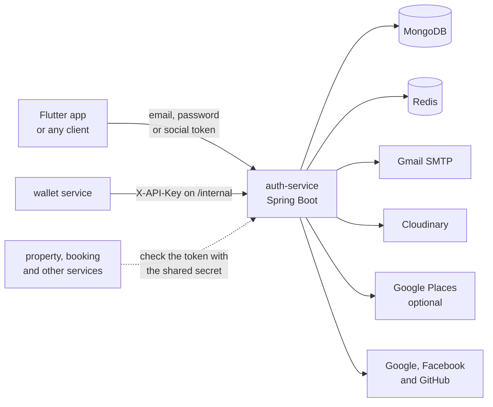

<div align="center">


<br/>

[](https://openjdk.org/projects/jdk/21/)
[](https://spring.io/projects/spring-boot)
[](docs/AUTHENTICATION.md)
[](https://www.mongodb.com)
[](https://redis.io)
[](docs/DEVELOPMENT.md)

[](docs/SOCIAL_SIGN_IN.md#google)
[](docs/SOCIAL_SIGN_IN.md#facebook)
[](docs/SOCIAL_SIGN_IN.md#github)
[](docs/CONFIGURATION.md#mail-and-profile-pictures)
[](docs/CONFIGURATION.md#mail-and-profile-pictures)
[](LICENSE)

[](https://github.com/peacemakerbill/premisave_auth_service/commits/main)
[](https://github.com/peacemakerbill/premisave_auth_service/stargazers)
[](https://github.com/peacemakerbill/premisave_auth_service/issues)
[](https://github.com/peacemakerbill/premisave_flutter_frontend)

**[Quick start](#quick-start)** &nbsp;|&nbsp; **[How it works](#how-it-works)** &nbsp;|&nbsp; **[Sign in](#sign-in-and-sessions)** &nbsp;|&nbsp; **[Access](#who-can-reach-what)** &nbsp;|&nbsp; **[Applications](#home-owner-applications)** &nbsp;|&nbsp; **[Docs](#documentation)**

</div>


## What is this?

The auth-service is the identity layer of the Premisave real estate platform. People sign up, sign in and manage their account here, and the other Premisave services (wallet, property, booking) trust the tokens it issues instead of running a login of their own.

It is a Spring Boot service with MongoDB for data and Redis for the token blacklist, the session cache and the sign-in throttles. The [Flutter app](https://github.com/peacemakerbill/premisave_flutter_frontend) is its main client, and any other client or service can use the same HTTP API.

| | |
| --- | --- |
| **Accounts** | Email and password with activation by email, password reset, and sign in with Google, Facebook or GitHub. |
| **Sessions you can see** | Every sign in is a server side session with two tokens. People can list their sessions and devices and end any of them. |
| **Alerts, not guesses** | A new device or an odd pattern sends an email with a "this was not me" link. Nothing is blocked automatically. |
| **Six roles** | Client, home owner, operations, finance, support and admin. Roles are only ever set on the server. |
| **Home Owner applications** | A client applies with documents, staff review it, and an admin promotes the account. Files stay on a disk you control. |
| **Profiles and social** | Profiles with pictures, likes, follows, reviews, profile views, location history and address search. |
| **A small internal API** | `/internal/**` lets other services check a user or a session with a shared key. |
| **One service to read** | 203 Java files, about 13 thousand lines, 118 endpoints. See [code at a glance](#code-at-a-glance). |


## Contents

- [Quick start](#quick-start)
- [How it works](#how-it-works)
- [Sign in and sessions](#sign-in-and-sessions)
- [Who can reach what](#who-can-reach-what)
- [Home Owner applications](#home-owner-applications)
- [Account security](#account-security)
- [API at a glance](#api-at-a-glance)
- [Talking to other services](#talking-to-other-services)
- [Configuration](#configuration)
- [Project layout](#project-layout)
- [Everyday commands](#everyday-commands)
- [Documentation](#documentation)
- [Known gaps](#known-gaps)
- [Built with](#built-with)
- [Code at a glance](#code-at-a-glance)
- [Contributing](#contributing)
- [License and author](#license-and-author)


## Quick start



The full walk through, with every prerequisite and the things that usually go wrong, is in **[docs/SETUP.md](docs/SETUP.md)**. The short version:

**1. Install the tools.** Java 21 and git. For the databases, Docker is the quickest way, or install MongoDB and Redis yourself.

**2. Start the databases and get the code.**

```bash
docker run -d --name auth-mongo -p 27017:27017 mongo:8
docker run -d --name auth-redis -p 6379:6379 redis:7

git clone https://github.com/peacemakerbill/premisave_auth_service.git
cd premisave_auth_service
```

**3. Configure.** Copy the template and fill in the keys the service cannot start without. They have no defaults on purpose:

```bash
cp .env.example .env
```

| Key | What it is |
| --- | --- |
| `JWT_SECRET` | Signs every token. Create one with `openssl rand -base64 32`. Other services that accept these tokens need the same value. |
| `API_KEY` | The shared secret other services send as `X-API-Key`. Create one with `openssl rand -hex 32`. |
| `GMAIL_PASSWORD` | A Gmail App Password, used to send activation and alert emails. Set `GMAIL_USERNAME` to the address that sends them. |
| `CLOUDINARY_CLOUD_NAME`, `CLOUDINARY_API_KEY`, `CLOUDINARY_API_SECRET` | Profile pictures. A free account works. |

MongoDB and Redis default to `localhost`, so a local setup needs nothing else. Set `SECURITY_DEVICE_COOKIE_SECURE=false` while you are on plain `http`, or the browser will not keep the device cookie.

**4. Run it.**

```bash
sh ./mvnw spring-boot:run
```

**5. Check it.**

```bash
curl http://localhost:8080/health
```

**6. Sign in.** Register through the [Flutter app](https://github.com/peacemakerbill/premisave_flutter_frontend), through the [browser console](test-client/README.md) or with curl, then open the activation link in the email. To get an administrator on the first start, set `ADMIN1_*` or `INITIAL_ADMIN_EMAILS` as described in [docs/ADMIN_AND_ACCOUNT_SECURITY.md](docs/ADMIN_AND_ACCOUNT_SECURITY.md).


## How it works



Every request goes through the same path. Filters look at who is calling, the route rules decide whether that caller may go on, a controller checks the input and a service does the work against MongoDB and Redis. The counts in the picture are read from the source, see [code at a glance](#code-at-a-glance).



A few choices shape the rest of the code:

- **One place for identity.** Other services never store passwords. They check the token signature, read `userId` and `roles`, and can ask this service about a user or a session.
- **Email is the login.** The token subject is the email address. The display username is a separate field that can be changed.
- **Two trust boundaries.** People use tokens. Services use `X-API-Key`. The two never mix.
- **Sessions on the server.** Each sign in creates a session. That is what makes "sign out everywhere" and "end this device" real, and what lets a stolen refresh token be detected.
- **Roles are set on the server.** The signup form has no role field, and a role sent by a client is ignored.

The full tour is in **[docs/ARCHITECTURE.md](docs/ARCHITECTURE.md)**.


## Sign in and sessions



A sign in returns two tokens. The **access token** is sent on every request. The **refresh token** is sent only to `POST /auth/refresh`, and it works once: each refresh returns a new pair and raises the session generation, so an old refresh token no longer matches. If an old one is used again, the service treats it as theft, revokes the session and records a critical event.

```bash
# Sign in
curl -s -X POST http://localhost:8080/auth/signin \
  -H 'Content-Type: application/json' \
  -d '{"email":"you@example.com","password":"your password"}'
# {"token":"...","refreshToken":"...","role":"CLIENT","expiresIn":2592000}

# Call a protected route
curl -s http://localhost:8080/profile/me -H "Authorization: Bearer $TOKEN"

# Trade the refresh token for a new pair
curl -s -X POST http://localhost:8080/auth/refresh \
  -H 'Content-Type: application/json' -d "{\"refreshToken\":\"$REFRESH\"}"
```

By default an access token lasts about 30 days, which is long. Set `SECURITY_ACCESS_TOKEN_MINUTES` to a value between 15 and 60 once your clients use the refresh token, so a revoked session stops working everywhere within that time. The reasons and the details are in **[docs/AUTHENTICATION.md](docs/AUTHENTICATION.md)**.


## Who can reach what



The matrix is read from `SecurityConfig` and `ApiKeyFilter` by [`tool/readme_assets.py`](tool/readme_assets.py). The roles are `CLIENT`, `HOME_OWNER`, `ADMIN`, `OPERATIONS`, `FINANCE` and `SUPPORT`. Staff routes accept `ADMIN`, `OPERATIONS`, `FINANCE` and `SUPPORT`, and admin routes accept `ADMIN` only. Individual endpoints can add their own checks on top, such as asking for the password again before a device is trusted.


## Home Owner applications



A client who owns or manages property applies to become a home owner. They fill in a form and upload documents, staff review it, and an admin makes the final decision by promoting the account. Every step is emailed, every change is written to the application's timeline, and the files are kept on a disk you control, never in the database or in a third party service. The rules, the documents each owner type needs and the storage setup are in **[docs/HOME_OWNER_APPLICATIONS.md](docs/HOME_OWNER_APPLICATIONS.md)** and **[docs/STORAGE.md](docs/STORAGE.md)**.


## Account security



Beyond the password, the service keeps a record of devices and sessions and scores each sign in. A score at or above the threshold sends an email with a "this was not me" link. Opening the link changes nothing by itself: the app shows the report first, and only a button press ends the session and removes trust from the device.

- **Progressive throttling.** Repeated failures lock the account, and the lock grows, up to four hours. An address that fails too often or tries too many accounts is locked too. Locks expire on their own.
- **Step up.** Sensitive changes, such as trusting a device, ask for the password again. A fresh social sign in counts.
- **Audit trail.** Sign ins, failures, role changes, revocations and alerts are written to an event log that no endpoint can edit or delete.
- **Neutral signup.** One setting makes signup answer the same for a new and an existing email.
- **Administrators from configuration.** Up to three admins can be created at startup, and invitation links cover the rest. Nothing has a default password.

All of it, with the settings, is in **[docs/ADMIN_AND_ACCOUNT_SECURITY.md](docs/ADMIN_AND_ACCOUNT_SECURITY.md)**.


## API at a glance



Every error has the same JSON shape with `timestamp`, `status` and `message`, and validation errors add an `errors` map by field. The complete list of endpoints, with the body and the answer for each group, is in **[docs/API.md](docs/API.md)**. A Postman collection is in [`postman/`](postman), and the [browser console](test-client/README.md) exercises most of the API from a single page.


## Talking to other services

Other Premisave services use this one in two ways, and [docs/INTEGRATION.md](docs/INTEGRATION.md) has the details:

1. **Check the token yourself.** Use the same `JWT_SECRET` and the same key derivation, then read `userId`, `email`, `roles` and `sid` from the claims.
2. **Ask this service.** Send `X-API-Key` to `GET /internal/users/validate-email/{email}`, `GET /internal/users/{email}/details` or `GET /internal/sessions/{sid}`.

A service that only checks the signature cannot know that a session was revoked until the access token expires. That is why short access tokens matter.


## Configuration

`application.yml` reads 109 environment variables, and only six of them are required. Everything else has a default, so a missing value never stops the service from starting. [`.env.example`](.env.example) lists them with a short comment each, and **[docs/CONFIGURATION.md](docs/CONFIGURATION.md)** explains them by group: core, mail and pictures, sessions, alerts, throttling, administrators, social sign in, storage, applications and places.

Values are read at startup, so restart the service after changing `.env`. Real environment variables work too. Never commit `.env`.

## Project layout

```text
premisave_auth_service/
|-- src/main/java/com/premisave/auth/
|   |-- controller/     17 controllers, one per area of the API
|   |-- service/        business rules
|   |   |-- security/   sessions, devices, throttling, risk, alerts, audit
|   |   |-- application/ Home Owner applications and their review
|   |   |-- oauth/      one client per social provider
|   |   |-- storage/    document storage on a disk or a mounted share
|   |   `-- places/     the Google Places proxy
|   |-- security/       the filters, the token service, user details
|   |-- config/         security rules, Redis, Mongo, mail, Cloudinary, startup runners
|   |-- entity/         MongoDB documents
|   |-- repository/     Spring Data repositories
|   |-- dto/            request and response types
|   |-- enums/          roles, statuses, document types and more
|   |-- exception/      one error shape for the whole API
|   `-- util/           the rate limiter interceptor
|-- src/main/resources/
|   |-- application.yml
|   `-- templates/email HTML emails
|-- docs/               guides, and the pictures in docs/assets
|-- tool/               readme_assets.py redraws the pictures
|-- postman/            collection and environment
|-- test-client/        auth-console.html, a browser console for the API
|-- oauth-test/         oauth-test.html, a tester for the social sign in flows
|-- .github/workflows/ redraws the pictures when the source changes
`-- .env.example        every setting, with its default
```

## Everyday commands

```bash
sh ./mvnw spring-boot:run          # run with the settings from .env
sh ./mvnw -q -DskipTests package   # build target/premisave_auth_service-0.0.1-SNAPSHOT.jar
java -jar target/premisave_auth_service-0.0.1-SNAPSHOT.jar
python3 tool/readme_assets.py      # redraw the pictures after a big change
```

`.env` is read from the folder you start the service in. More on building, the tests and how to add an endpoint is in [docs/DEVELOPMENT.md](docs/DEVELOPMENT.md).


## Documentation

| Guide | What is in it |
| --- | --- |
| [docs/SETUP.md](docs/SETUP.md) | Install, configure, run and check, step by step, with the problems people usually hit. |
| [docs/ARCHITECTURE.md](docs/ARCHITECTURE.md) | The layers, the filters, the data model, background jobs and the choices behind them. |
| [docs/AUTHENTICATION.md](docs/AUTHENTICATION.md) | Tokens, sessions, refresh rotation, devices, throttling and logout. |
| [docs/SOCIAL_SIGN_IN.md](docs/SOCIAL_SIGN_IN.md) | Setting up Google, Facebook and GitHub, and the two ways a client can sign in. |
| [docs/API.md](docs/API.md) | Every endpoint, grouped, with who may call it. |
| [docs/CONFIGURATION.md](docs/CONFIGURATION.md) | Every setting, by group, with its default. |
| [docs/ADMIN_AND_ACCOUNT_SECURITY.md](docs/ADMIN_AND_ACCOUNT_SECURITY.md) | Administrators, alerts, scoring, retention and the limits of it all. |
| [docs/HOME_OWNER_APPLICATIONS.md](docs/HOME_OWNER_APPLICATIONS.md) | The application workflow, documents, review and emails. |
| [docs/STORAGE.md](docs/STORAGE.md) | Keeping documents on a local disk or on a network share mounted by the operating system. |
| [docs/INTEGRATION.md](docs/INTEGRATION.md) | The token contract and the internal API, for other services. |
| [docs/DEPLOYMENT.md](docs/DEPLOYMENT.md) | A checklist for going live. |
| [docs/DEVELOPMENT.md](docs/DEVELOPMENT.md) | Building, testing, adding an endpoint, and how the pictures are made. |
| [docs/TROUBLESHOOTING.md](docs/TROUBLESHOOTING.md) | Symptoms and fixes. |


## Known gaps

These are real, and worth knowing before you go live. [docs/DEPLOYMENT.md](docs/DEPLOYMENT.md) says what to do about each.

- **Access tokens are long by default.** About 30 days until `SECURITY_ACCESS_TOKEN_MINUTES` is set.
- **The rate limiter is one shared bucket.** It lives in memory in each instance, it is not per client and it is not backed by Redis, so it protects the service from floods and does little against one noisy caller. The throttling of sign in failures is separate, per account and per address, and it does use Redis.
- **CORS allows every origin, with credentials.** That is convenient in development and must be limited to your real front end addresses in production.
- **Sign up checks no password strength.** It only needs a value that is not blank. Changing and resetting a password need 8 characters. Enforce a minimum in your client, or add `@Size(min = 8)` to `SignupRequest`.
- **Unexpected errors show their message.** A 500 answer includes a `debugMessage` with the exception text, and a plain `RuntimeException` answers 400. Remove the field before production.
- **`/health` always says UP.** It does not check MongoDB, Redis or mail.
- **Logging is verbose.** `com.premisave.auth` and Spring Data MongoDB log at `DEBUG` by default.
- **No second factor.** Suspicious sign ins are scored and alerted, not challenged.
- **Two defaults to replace.** `application.yml` falls back to a personal address for `GMAIL_USERNAME` and `SUPPORT_EMAIL`. Set both in production.
- **Leftovers.** `/swagger-ui/**` and `/v3/api-docs/**` are allowed in the route rules, but no Swagger library is in the build, and `/test/**` has no controller. The `spring-boot-starter-amqp` and Bucket4j Lettuce dependencies are not used. The `bin/` folder is committed IDE output and can be deleted.
- **One test.** The only test starts the application, so it needs the required settings in the shell and a running MongoDB. The behaviour described in these docs was checked against the source, not against a test suite.


## Built with




## Code at a glance

These charts are counted from the real source by [`tool/readme_assets.py`](tool/readme_assets.py), blank lines and comments excluded. A GitHub Action redraws them after changes to the code, or run the script yourself.


## Contributing

1. Make a branch from `main`.
2. Put code where it belongs: a controller checks input and calls a service, a service holds the rule, and only services and repositories talk to MongoDB.
3. Keep errors in the one JSON shape by throwing `ApiException`.
4. Do not log a token, a password or a full email address, and do not commit `.env`.
5. Update the matching guide in `docs/` when behaviour changes, then run `python3 tool/readme_assets.py`.
6. Make sure `sh ./mvnw -q -DskipTests package` builds.

Open an [issue](https://github.com/peacemakerbill/premisave_auth_service/issues) first if the change is large, so we can agree on the shape of it.

## License and author

Released under the [MIT License](LICENSE). This is an independent project and is not affiliated with Google, Meta, GitHub, Cloudinary or any other provider it connects to. Follow each provider's own current documentation for credentials and production rules.

<table>
  <tr>
    <td align="center" width="180">
      <a href="https://github.com/peacemakerbill">
        <br/>
        <sub><b>Bill Graham Peacemaker</b></sub>
      </a>
    </td>
    <td>
      <b>Backend Developer &amp; API Support Engineer at Safaricom PLC</b><br/>
      Nairobi, Kenya<br/><br/>
      Enterprise systems developer and API integration specialist, working across backend microservices (Java and Spring Boot), Flutter frontends and DevOps.<br/><br/>
      <a href="https://github.com/peacemakerbill"></a>
      <br/><br/>
      Related: <a href="https://github.com/peacemakerbill/premisave_flutter_frontend">premisave_flutter_frontend</a> ·
      <a href="https://github.com/peacemakerbill/premisave-wallet-service">premisave-wallet-service</a> ·
      <a href="https://github.com/peacemakerbill?tab=repositories">all repositories</a>
    </td>
  </tr>
</table>
