<!-- band -->

# Administrator provisioning and account security

How administrators come to exist, and how the service watches sign ins and tells the owner about anything unusual. For the token and session rules see [AUTHENTICATION.md](AUTHENTICATION.md), and for every setting named here see [CONFIGURATION.md](CONFIGURATION.md).

## 1. Configuring administrators

Two comma-separated lists, set in `.env` (or the real environment) and read at startup:

| Variable | Effect |
|---|---|
| `INITIAL_ADMIN_EMAILS` | Provisioned at startup. A verified account with that email is promoted to ADMIN. If no account exists, an unverified ADMIN account is created with a random unknown password and an invitation email is sent. The owner opens the link and chooses their own password. |
| `AUTO_ADMIN_EMAILS` | The account becomes ADMIN automatically once its email is verified (email verification, password reset, sign-in, social login or account linking). |

Both lists are optional. Entries are trimmed, lower-cased, validated and de-duplicated, and invalid entries are logged and skipped. An empty or missing variable never stops startup. After editing either list, restart the service.

There is no default admin account and no default password anywhere in the code (the `ADMINn_PASSWORD` settings have no default and are empty unless you set them). The old initializer, which created an account with a fixed password, is gone. `AdminProvisioningRunner` replaces it, and no test guards against one coming back, so look for hardcoded credentials in review.

### Administrators created from ADMIN1, ADMIN2 and ADMIN3

For a fixed set of owners you can also create up to three administrator accounts directly from `.env`. Unlike the two lists above, these carry a password, so the rules are stricter. Nothing has a default, so an unfilled slot creates nothing.

| Variable (n is 1, 2 or 3) | Meaning |
|---|---|
| `ADMINn_EMAIL` | Sign-in address. Required for a used slot, because sign-in is by email. |
| `ADMINn_USERNAME` | Optional public handle (3 to 30 characters: letters, digits, `.`, `_`, `-`). Generated from the name when empty. It is not used to sign in. |
| `ADMINn_FIRST_NAME` | Required. |
| `ADMINn_MIDDLE_NAME`, `ADMINn_LAST_NAME` | Optional. |
| `ADMINn_PASSWORD` | Required. At least 8 characters (72 bytes at most), two of lower case, upper case, digits and symbols, not a well-known password, not containing the email or username. |
| `ADMINS_ENABLED` | `true` by default. `false` ignores all three slots. |
| `ADMINS_STRICT` | `false` by default. `true`: an invalid slot stops startup and nothing is created. |
| `ADMINS_PROMOTE_EXISTING` | `false` by default. `true`: an existing verified, active, non-admin account with the same email is promoted. |
| `ADMINS_MIN_PASSWORD_LENGTH` | `8`. Values below 8 are raised to 8. |

What happens at startup (before the `INITIAL_ADMIN_EMAILS` step):

* **No account with that email:** an ADMIN account is created, already verified and active (the person who controls the environment vouches for the address, so no invitation is needed). The password is stored only as a BCrypt hash. An `ADMIN_PROVISIONED` audit event is written with source `CONFIG` and the slot name.
* **Account already ADMIN:** nothing changes, including its password, names and status. A deactivated administrator stays deactivated.
* **Account exists, not ADMIN:** left alone, with a warning, unless `ADMINS_PROMOTE_EXISTING=true` and the account is verified, active and not archived. A promotion never changes the password, and is audited and announced by email like any other role grant. An unverified account is never promoted, so someone who registered an address first cannot be turned into an administrator by configuration.
* **Invalid slot:** skipped, and the log names the slot and the problem ("ADMIN2 is not used: password is shorter than 8 characters"), never the value. Valid slots still run unless `ADMINS_STRICT=true`.
* **Never:** a password is overwritten, an account is demoted or deactivated, or a password, hash or full email address is logged or audited.

Starting again is harmless: existing accounts are found and nothing is created or sent a second time. The plain-text password is cleared from the in-memory settings once it has been hashed.

This reverses an earlier rule ("no password in the environment, invitation links only"). It is a convenience trade-off: a password in `.env` is only as safe as that file. Keep `.env` out of git, readable by the service user only, change the password after the first sign-in, and then remove it from `.env`. Because existing accounts are never touched, the password in `.env` is only ever used for the first creation. For anyone else, `INITIAL_ADMIN_EMAILS` (invitation link, nobody ever knows a password) remains the safer path.

Spring's `/actuator/env`, if you expose it, masks values whose key ends in `password`. Do not expose it publicly anyway.

### Revocation and demotion policy

* Removing an email from either list never demotes anyone.
* A listed, verified, active account is re-promoted at its next sign-in. To keep someone demoted, remove the email from both lists first, then change the role.
* Roles change through `PUT /admin/users/change-role/{id}`. Each change is audited with actor, target, reason and time. The last remaining ADMIN cannot be demoted.
* Unverified, deactivated or archived accounts never receive ADMIN, whatever the lists say.
* The client can never choose a role: `SignupRequest` has no role field, and social logins always create CLIENT accounts.

### Testing the invitation flow

1. Set `INITIAL_ADMIN_EMAILS=you@yourdomain.com` and make sure Gmail SMTP works.
2. Start the service. Check the log for the provisioning line and your inbox for the invitation.
3. Open the link (frontend route `/admin-invitation?token=...`). The page posts to `POST /auth/admin-invitation/accept`.
4. Start again. No second account and no second email should appear while the invitation is valid.

## 2. Testing the sign-in alert

1. Make sure `SECURITY_LOGIN_EMAIL_NOTIFICATIONS=true` and `SECURITY_NEW_DEVICE_ALERTS=true`.
2. Create an account and sign in once. The first device of a brand new account is not alerted unless `SECURITY_ALERT_FIRST_DEVICE=true`.
3. Sign in again with the device cookie (`ps_did`) removed, or from a different browser. This counts as a new device and an alert email is sent.
4. Repeat from the same browser. No new alert is sent, and an untrusted but known device is re-alerted only after `SECURITY_DEVICE_ALERT_COOLDOWN_HOURS`.
5. Open "This wasn't me" in the email. The page must call `POST /auth/security-actions/inspect` first, then `confirm` after the user presses a button. Opening the link alone changes nothing.
6. If no email arrives, search the audit trail for `NOTIFICATION_FAILED` (`GET /admin/security/events?type=NOTIFICATION_FAILED`). It records the template and the error class only.

Local development over plain http needs `SECURITY_DEVICE_COOKIE_SECURE=false`, otherwise the browser will not store the device cookie.

## 3. Geolocation, proxies and MFA

* IP location is off by default (`SECURITY_IP_GEOLOCATION_ENABLED=false`). Turning it on sends visitor IPs to the provider in `SECURITY_IP_GEOLOCATION_URL` (default `https://ipwho.is/{ip}`; any JSON provider with `country`, `region`, `city` fields works). The result is approximate, can be wrong for VPNs, mobile carriers and corporate networks, and is labelled as approximate in emails. A lookup failure never blocks a sign-in.
* `X-Forwarded-For` is trusted only from addresses in `SECURITY_TRUSTED_PROXIES` (IPs or CIDR). Leave it empty when the service is reached directly. Behind a load balancer set it, or every user will appear to come from the balancer.
* MFA is not implemented. Suspicious sign-ins are scored, audited and alerted, and the owner can end sessions. Nothing is blocked automatically except the throttling lock. The scoring service is the place to plug a second factor into.
* Email delivery uses the existing Gmail SMTP settings. No new external service is required.

## 4. What the audit trail records

Every event in `security_events` is written by `SecurityAuditService` and is never edited or deleted by an endpoint. Besides the event type, severity, time and reason, each event now keeps:

* **Outcome:** `SUCCESS` or `FAILURE`. Failed and throttled sign ins, lockouts, refresh token reuse and failed notifications default to `FAILURE`.
* **Who:** the person it happened to (`userId`), the actor (`actor`, which is `SYSTEM` or `ANONYMOUS` when no one was signed in) and the actor's role when the actor is the signed in person.
* **Where from:** IP address, the raw User-Agent (capped at 200 characters), a readable device label, device type, browser and operating system. Country, region and city are added only when IP location is on and the address was already looked up, so writing an event never waits for the provider.
* **What it touched:** `targetType`, `targetId` and `targetLabel`, for example `USER`, the account id and the name with a masked email, or `APPLICATION` and the application number.
* **The request:** HTTP method and path. Long ids in the path are shown as `{id}` and the query string is never kept.
* **Details:** small key and value pairs such as `from` and `to` on a status change, or `changed` on a user update. Keys that look like secrets are dropped and values are capped at 200 characters.

Events recorded for staff actions: `USER_CREATED`, `USER_UPDATED` (with the list of fields that changed, never their values), `USER_DELETED`, `USER_ARCHIVED`, `USER_UNARCHIVED`, `USER_ACTIVATED`, `USER_DEACTIVATED`, `USER_VERIFIED_BY_ADMIN`, `USER_UNVERIFIED_BY_ADMIN`, `APPLICATION_STATUS_CHANGED`, `HOME_OWNER_PROMOTED` and `STORAGE_SETTINGS_CHANGED`. Events recorded for people: `SIGN_UP`, `EMAIL_VERIFIED`, `PASSWORD_RESET_REQUESTED` and `PROFILE_UPDATED`, next to the sign in, session, device and password events that were already there.

People see only their own security events at `GET /security/events`. Staff actions on their account (the events above that start with `USER_`, application and storage events) are left out of that list, so an administrator's address is not shown to the person it was done to.

**Search.** `GET /admin/security/events?q=` takes free text, so an administrator can type a name, username, email, phone number, IP address, place, device, browser, event type, request path, reason or id. Several words narrow the result, because every word (at most five) must match. Names, usernames, emails and phones are looked up in the accounts collection, then events about or by those accounts are returned, so a full email address works even though only a masked one is stored with the event. The search scans the audit collection, so `SECURITY_AUDIT_RETENTION_DAYS` keeps it quick, and the time filters narrow it further.

**Staff changes.** `GET /admin/security/events?group=staff` lists every staff action above, plus role changes and role assignments: the same events the summary counts as `adminChanges`, so the list behind that figure matches it. It is ignored when `type` is set.

New indexes for the filters (`severity_time`, `actor_time`, `ip_time`) are created at startup.

## 5. Data kept

Collections: `security_events` (immutable audit trail, no endpoint edits or deletes it), `known_devices`, `user_sessions`, `security_action_tokens`, `sign_in_history`. Email action tokens and device tokens are stored only as SHA-256 hashes. Refresh tokens are not stored at all: the session keeps a generation counter, and the token's `gen` claim must match it. Indexes are created at startup, including TTL indexes. `SecurityRetentionJob` removes audit events older than `SECURITY_AUDIT_RETENTION_DAYS` and stale devices after `SECURITY_DEVICE_RETENTION_DAYS`. It needs `SchedulingConfig` with `@EnableScheduling`.

## 6. Frontend pages these flows need

The service sends links, and the front end has to have a page behind each one. The [Flutter app](https://github.com/peacemakerbill/premisave_flutter_frontend) already has them. A different front end must build: `/admin-invitation?token=`, `/security-report?token=` (inspect, then confirm) and `/account/security` (sessions and devices). The paths come from `FRONTEND_URL` and `SECURITY_PAGE_PATH`.

## 7. Short access tokens

`SECURITY_ACCESS_TOKEN_MINUTES` (default 0, which keeps `JWT_EXPIRATION`) sets the lifetime of session-bound access tokens. With 15 to 60, a revoked session stops working in every service within that time, because the refresh token is rejected as soon as the session is revoked. Sign-in and refresh responses carry `expiresIn` (seconds) so clients can refresh ahead of time.

Before turning it on, make sure every client stores `refreshToken` and calls `POST /auth/refresh` with `{"refreshToken": "<refreshToken>"}` when the access token is close to expiry or a request returns 401. Each refresh token works once and is replaced by the new one in the response. Older clients that send their access token to `/auth/refresh` still work only while that token is unexpired.

## 8. Neutral signup

`SECURITY_HIDE_EXISTING_ACCOUNTS=true` makes `POST /auth/signup` return `202` with the same message for a new and an already-registered email, and no tokens. A new address gets an account and a verification email. An existing address gets a "someone tried to register with your email" notice (at most once an hour) and nothing is changed. The user signs in after verifying, so the client must stop expecting tokens from signup. Password hashing is done in both cases so response time gives little away, but a determined attacker may still measure small differences. A taken username is still reported, because usernames are not secret.

## 9. Limitations

* Device recognition is a cookie plus a user-agent summary. It is not unique identification, and the user agent is spoofable.
* Location is approximate and off by default.
* Throttling fails open if Redis is unavailable, so sign-in keeps working but is not limited.
* Tokens issued before this upgrade have no session id. They keep working until `SECURITY_LEGACY_REFRESH_ENABLED=false`, and cannot be revoked individually.
* Access tokens last as long as `JWT_EXPIRATION` (about 30 days) until you set `SECURITY_ACCESS_TOKEN_MINUTES` (see section 6). Sibling services only check the signature, so until that is set a revoked session stays valid for them unless they call `GET /internal/sessions/{sid}?userId=` (protected by `X-API-Key`).
* Signup answers "Email already exists" until you set `SECURITY_HIDE_EXISTING_ACCOUNTS=true` (see section 7).
* CORS is open to every origin, with credentials allowed, and must be restricted for production. See [DEPLOYMENT.md](DEPLOYMENT.md#before-you-go-live).
* There is one automated test, which only checks that the application starts. The rules in this document have no tests yet. See [DEVELOPMENT.md](DEVELOPMENT.md#tests) for where to start.
* A configured administrator password lives in `.env` until you remove it. Treat that file like any other secret.