<!-- band -->
<div align="center">



[](AUTHENTICATION.md)
[](INTEGRATION.md)
[](../postman)
[](API.md)
[](https://github.com/peacemakerbill/premisave_auth_service/commits/main/docs/API.md)

</div>

# API reference

Every endpoint of the auth-service, grouped by what it is for. There are 118 of them in 17 controllers. The Postman collection in [`postman/`](../postman) has a ready request for each, and [`test-client/auth-console.html`](../test-client/README.md) lets you try the common ones in a browser.

## Contents

- [Conventions](#conventions)
- [Sign in and accounts](#sign-in-and-accounts)
- [Security links from email](#security-links-from-email)
- [Profile](#profile)
- [Profile views](#profile-views)
- [Social](#social)
- [Location and places](#location-and-places)
- [Sessions, devices and history](#sessions-devices-and-history)
- [Home Owner applications](#home-owner-applications)
- [Staff review](#staff-review)
- [Administration](#administration)
- [Service to service](#service-to-service)
- [Public](#public)






## Conventions

**Base address.** `http://localhost:8080` locally. There is no path prefix and no version segment.

**Bodies.** JSON, `Content-Type: application/json`, except the two upload endpoints, which are `multipart/form-data`. Unknown fields in a body are ignored.

**Signing in.** Send the access token on every protected call:

```text
Authorization: Bearer <access token>
```

**Who may call.** The *Access* column uses these words:

| Word | Meaning |
| --- | --- |
| Public | No token. |
| Signed in | Any valid access token. |
| Staff | `ADMIN`, `OPERATIONS`, `FINANCE` or `SUPPORT`. |
| Admin | `ADMIN` only. |
| Owner | Signed in, and the record must belong to the caller. |
| API key | `X-API-Key: <API_KEY>`, for other services. No user token. |

**Headers that matter.**

| Header | Used for |
| --- | --- |
| `X-Client-Platform: mobile` | Asks sign in and refresh to return `deviceToken` in the body, because an app has no cookie jar. |
| `X-Device-Token` | An app sends back the device token it was given, so the device is recognised. Browsers use the `ps_did` cookie instead. |
| `X-Forwarded-For` | Used for the caller's address only when the request came from a proxy in `SECURITY_TRUSTED_PROXIES`. |
| `X-API-Key` | Service calls to `/internal/**` and `/profile/public/directory`. |

**Sign in answer.** Sign up (in the default mode), sign in, the three social endpoints and refresh all return the same shape:

```json
{
  "token": "<access token>",
  "role": "CLIENT",
  "refreshToken": "<refresh token>",
  "expiresIn": 2592000,
  "deviceToken": "<only for X-Client-Platform: mobile>"
}
```

**Errors.** One JSON shape, with one exception: the request rate limiter answers `429` with an **empty body**, so a client must not assume it can parse one. See [ARCHITECTURE.md](ARCHITECTURE.md#errors).

| Status | When |
| --- | --- |
| 400 | A rule was broken, or the body failed validation (then with an `errors` map). |
| 401 | No token, a bad token, an ended session, or a wrong password. |
| 403 | The role is not allowed, or the account is not verified or is deactivated. |
| 404 | The record does not exist, or is not the caller's. |
| 429 | Too many attempts. Sign in throttling says how many minutes to wait. The request rate limiter sends no body. |
| 503 | Application file storage is not available. |

**Rate limits.** Besides sign in throttling, one shared bucket (`RATE_LIMIT_REQUESTS_PER_MINUTE`) covers `POST /auth/signup`, `/auth/signin`, `/auth/reset-password`, `/auth/forgot-password`, `/social/like`, `/social/follow` and `/social/review`. See [CONFIGURATION.md](CONFIGURATION.md#throttling).

## Sign in and accounts

| Method and path | Access | Does |
| --- | --- | --- |
| `POST /auth/signup` | Public | Registers a `CLIENT`. Body: `firstName`, `lastName`, `email`, `phoneNumber`, `password` (all required); `username`, `middleName`, `address1`, `address2`, `country`, `language` (optional). A `role` in the body is ignored. Answers with tokens, or `202` and a neutral message when `SECURITY_HIDE_EXISTING_ACCOUNTS=true`. Sends the activation email. |
| `GET /auth/verify/{token}` | Public | Activates an account from the emailed token. Tokens are single use and last 24 hours. |
| `POST /auth/resend-activation?email=` | Public | Sends the activation mail again. The answer is the same for every address. |
| `POST /auth/signin` | Public | Body: `email`, `password`. Returns the sign in answer. |
| `POST /auth/google` | Public | Body: `token`, optional `redirectUri`. See [SOCIAL_SIGN_IN.md](SOCIAL_SIGN_IN.md). |
| `POST /auth/facebook` | Public | Same body. |
| `POST /auth/github` | Public | Body: `token` (a code or an access token). |
| `POST /auth/refresh` | Public | Body: `refreshToken`. Returns a new pair. A refresh token works once. See [AUTHENTICATION.md](AUTHENTICATION.md#refreshing-and-why-a-refresh-token-works-once). |
| `POST /auth/logout` | Signed in | Blacklists the token in the `Authorization` header and ends its session. |
| `POST /auth/forgot-password` | Public | Body: `email`. Sends a reset link. The answer is the same for every address. |
| `POST /auth/reset-password` | Public | Body: `token`, `newPassword`, `confirmPassword` (at least 8 characters). Ends every session. |
| `POST /auth/change-password` | Signed in | Body: `oldPassword`, `newPassword`, `confirmPassword`. Ends the other sessions. |

Examples:

```bash
curl -s -X POST http://localhost:8080/auth/signin \
  -H 'Content-Type: application/json' \
  -d '{"email":"you@example.com","password":"a long passphrase"}'

curl -s -X POST http://localhost:8080/auth/refresh \
  -H 'Content-Type: application/json' \
  -d '{"refreshToken":"<refresh token>"}'

curl -s -X POST http://localhost:8080/auth/logout \
  -H "Authorization: Bearer $TOKEN"
```

## Security links from email

These are `POST` on purpose. A `GET` that changes something is triggered by mail scanners and link previews. The front end opens a page from the link, reads `?token=`, and calls these.

| Method and path | Access | Does |
| --- | --- | --- |
| `POST /auth/security-actions/inspect` | Public | Body: `token`. Shows what was reported. Changes nothing and does not use the token up. |
| `POST /auth/security-actions/confirm` | Public | Body: `token`, `requestPasswordReset` (true or false). "This was not me": ends the session, removes device trust, emails the owner, and can start a password reset. Single use. |
| `POST /auth/admin-invitation/accept` | Public | Body: `token`, `newPassword`, `confirmPassword`. A pre-provisioned administrator chooses a password and activates the account. Single use. |

## Profile

| Method and path | Access | Does |
| --- | --- | --- |
| `GET /profile/me` | Signed in | The caller's own profile. |
| `GET /profile/user/{userId}` | Signed in | Another person's public profile. |
| `GET /profile/search?query=` | Signed in | Search people by name, username or email. |
| `GET /profile/all` | Signed in | All active people, for browsing. |
| `PUT /profile/update` | Signed in | Body: any of `username`, `firstName`, `middleName`, `lastName`, `phoneNumber`, `address1`, `address2`, `country`, `language`. |
| `POST /profile/upload-profile-picture` | Signed in | Multipart, field `file`. The picture is stored on Cloudinary. |
| `POST /profile/change-password` | Signed in | Body: `currentPassword`, `newPassword`, `confirmPassword`. |
| `GET /profile/public/directory` | API key | Id, email and phone number of every active, non-archived user, for other services. Keep the key private. |

## Profile views

| Method and path | Access | Does |
| --- | --- | --- |
| `POST /profile/views/{targetId}` | Signed in | Records that the caller looked at a profile. |
| `GET /profile/views/who-viewed-me` | Signed in | Who looked at the caller's profile. Each row has `viewerId`, `viewerName` and `viewerProfilePicture`. |
| `GET /profile/views/who-i-viewed` | Signed in | Profiles the caller looked at. Each row has `targetId`, `targetName`, `targetUsername` and `targetProfilePicture`. |
| `GET /profile/views/my-stats` | Signed in | The caller's view statistics. |
| `GET /profile/views/stats` | Signed in | Own statistics, or another person's total with `?userId=`. |
| `GET /profile/views/stats/{userId}` | Signed in | Another person's public statistics (the total only). |

## Social

All of `/social/**` needs a signed in caller. The write actions share the rate limit bucket.

| Method and path | Does |
| --- | --- |
| `POST /social/like`, `DELETE /social/unlike/{targetId}` | Like or unlike a person. Body: `targetId`. |
| `POST /social/follow`, `DELETE /social/unfollow/{targetId}` | Follow or unfollow. Body: `targetId`. |
| `POST /social/review` | Write a review. Body: `targetId`, `rating`, `comment` (up to 1000 characters). |
| `PUT /social/review` | Edit a review. Body: `reviewId`, `rating`, `comment`. |
| `DELETE /social/review/{reviewId}` | Delete the caller's own review. |
| `GET /social/reviews/{targetId}` | Reviews about a person. |
| `GET /social/stats/{userId}` | Likes, followers and review totals for a person. |
| `GET /social/my-likes`, `/my-likers` | Who the caller likes, and who likes the caller. |
| `GET /social/my-following`, `/my-followers` | Who the caller follows, and who follows the caller. |
| `GET /social/my-reviews`, `/my-written-reviews` | Reviews about the caller, and reviews the caller wrote. |
| `GET /social/like/status/{targetId}` | `{ "liked": true }`. |
| `GET /social/follow/status/{targetId}` | `{ "following": true }`. |
| `GET /social/review/status/{targetId}` | `{ "reviewed": true }`. |
| `GET /social/follow/mutual/{targetId}` | `{ "mutual": true }`. |

## Location and places

| Method and path | Access | Does |
| --- | --- | --- |
| `PUT /location` | Signed in | Body: `latitude`, `longitude` (required), `locationName`, `address`, `country`, `city`. Saves the current location and keeps history. |
| `GET /location/current` | Signed in | The latest location. |
| `GET /location/history?limit=` | Signed in | History, newest first. The default is 100 and the most is 500. |
| `GET /places/status` | Signed in | `{ "enabled": true, "provider": "google" }`. Lets an app choose its search without trying and failing. |
| `GET /places/suggest?q=&country=&session=` | Signed in | Address suggestions. `q` is 2 to 120 characters, `country` a two letter code, `session` an 8 to 64 character token that groups one search. |
| `GET /places/details?id=&session=` | Signed in | Coordinates and address parts for a suggestion. |
| `GET /places/reverse?lat=&lng=` | Signed in | The address at a point. `404` when nothing is known there. |

The Google key stays on the server. Places calls are limited per user, see [CONFIGURATION.md](CONFIGURATION.md#places).

## Sessions, devices and history

All of `/security/**` needs a signed in caller and only ever touches the caller's own records. A record that belongs to someone else answers 404.

| Method and path | Does |
| --- | --- |
| `GET /security/sessions` | Active sessions, with `current` marking the one making the call. |
| `DELETE /security/sessions/{id}` | End one session. `403` if `SECURITY_SESSION_REVOCATION_ENABLED=false`. |
| `POST /security/sessions/revoke-others` | End every session except this one. Answers `{ "count": 2, "message": "2 other sessions ended." }`. |
| `GET /security/devices` | Known devices with their active session counts. |
| `GET /security/devices/{id}` | One device and its ten latest sign ins. |
| `POST /security/devices/{id}/trust` | Body: `currentPassword`. Marks a device trusted, which stops "new device" alerts for it. Asks for the password again, see [step up checks](AUTHENTICATION.md#step-up-checks). |
| `DELETE /security/devices/{id}/trust` | Removes trust. |
| `POST /security/devices/{id}/revoke-credential` | The cookie or device token stops matching, so that browser is a new device next time. |
| `DELETE /security/devices/{id}` | Forget a device. Its sessions end. |
| `GET /security/sign-ins` | The 30 latest sign ins. |
| `GET /security/events` | The 50 latest security events about the account. |

## Home Owner applications

For the person applying. Every call works only on the caller's own application. The full flow, statuses and document rules are in [HOME_OWNER_APPLICATIONS.md](HOME_OWNER_APPLICATIONS.md).

| Method and path | Does |
| --- | --- |
| `GET /home-owner/applications/meta` | The lists the form needs: owner types, document types, statuses with labels, limits. |
| `GET /home-owner/applications/eligibility` | Whether the caller may start an application, and why not. |
| `POST /home-owner/applications` | Start a draft. The body is optional. |
| `GET /home-owner/applications/mine` | The caller's current application. |
| `GET /home-owner/applications` | All of the caller's applications, as summaries. |
| `GET /home-owner/applications/{id}` | One application with its documents, timeline and readiness. |
| `PATCH /home-owner/applications/{id}` | Save form fields. Fields that are left out are kept. |
| `POST /home-owner/applications/{id}/documents` | Multipart: `type`, `file`, optional `documentNumber`, optional `expiryDate` as `yyyy-MM-dd`. Answers `201`. |
| `DELETE /home-owner/applications/{id}/documents/{documentId}` | Remove a file. |
| `GET /home-owner/applications/{id}/documents/{documentId}/download` | The file, streamed. Add `?download=true` to force a download. |
| `POST /home-owner/applications/{id}/submit` | Send for review. Fails with the list of what is missing. |
| `POST /home-owner/applications/{id}/reapply` | Reopen a rejected application. |
| `POST /home-owner/applications/{id}/withdraw` | Withdraw. Body optional: `reason`. |
| `DELETE /home-owner/applications/{id}` | Delete a draft that was never submitted. |

## Staff review

For `ADMIN`, `OPERATIONS`, `FINANCE` and `SUPPORT`.

| Method and path | Does |
| --- | --- |
| `GET /staff/applications` | Search and list. Query: `q`, `status` (repeatable), `ownerType`, `country`, `region`, `assignee`, `sort` (default `oldest`), `page` (default 0), `size` (default 20). |
| `GET /staff/applications/stats` | Counts by status, awaiting review, unassigned, assigned to the caller, needing information, ready to promote, the average decision time in hours, and the oldest waiting application. |
| `GET /staff/applications/reviewers` | Staff who can be assigned. |
| `GET /staff/applications/{id}` | One application, with documents, timeline and staff notes. |
| `POST /staff/applications/{id}/claim` | Assign it to the caller. |
| `PUT /staff/applications/{id}/assign` | Body: `reviewerId`. |
| `POST /staff/applications/{id}/status` | Body: `status`, `message`, `internalNote`, `allowReapply`. A message is required for `INFO_REQUESTED` and `REJECTED`. Allowed moves are in [HOME_OWNER_APPLICATIONS.md](HOME_OWNER_APPLICATIONS.md#review). |
| `POST /staff/applications/{id}/documents/{documentId}/review` | Body: `status` (`VERIFIED` or `REJECTED`), `reason`, `requestReupload`. A reason is required when rejecting. |
| `POST /staff/applications/{id}/notes` | Body: `text`. A note only staff can read. |
| `GET /staff/applications/{id}/documents/{documentId}/download` | The file, streamed. |

## Administration

All of this is `ADMIN` only.

| Method and path | Does |
| --- | --- |
| `POST /admin/applications/{id}/promote` | The "Make Home Owner" button. Needs a `VERIFIED` application. Sets the applicant's role to `HOME_OWNER`, marks the application `ACCEPTED` and emails them. Body optional: `message`, `internalNote`. |
| `GET /admin/storage-settings` | Where documents are stored now, the allowed folders and the `.env` values. |
| `POST /admin/storage-settings/check` | Try storage values without saving. Body: `type`, `localPath`, `networkProtocol`, `networkHost`, `networkShare`, `networkMountPath`, `networkDirectory`, `networkRequireMount`, `minFreeMb`. |
| `PUT /admin/storage-settings` | Save them (the dashboard value then wins over `.env`). `400` with the reason when the folder is refused. |
| `DELETE /admin/storage-settings` | Go back to the `.env` values. |
| `GET /admin/storage-settings/browse` | The folder picker. Query `path` (a full path). Returns the folders inside it, or the allowed folders themselves when `path` is left out. Only folders inside the allowed roots are shown, hidden folders and links that lead outside are left out, and `400` says why a path is refused. |
| `POST /admin/storage-settings/folders` | Make a folder from the picker. Body: `parent` (a full path inside an allowed root) and `name` (one folder, letters, digits, dot, dash, underscore and space, starting with a letter or digit). Returns the new folder, ready to open. |
| `GET /admin/security/events` | The audit trail, newest first. Query: `q` (free text: up to five words, and every word must match something in the event, such as a name, username, email or phone of the person it happened to or who did it, an IP address, place, device, browser, system, event type, request, reason or id; "failed", "succeeded", "critical", "warning" and "info" also match the result and severity), `userId` (the person it happened to), `actor` (who did it), `type`, `group` (`staff` lists every change an administrator makes, the events the summary counts as staff changes; ignored when `type` is set), `severity` (`INFO`, `WARNING`, `CRITICAL`), `outcome` (`SUCCESS`, `FAILURE`), `ip`, `from`, `to` (a date such as `2026-11-18` or a full instant; a `to` date includes that whole day), `page` (default 0), `size` (default 50, most 100). Each row carries the person and the actor with name and masked email, device, browser, system, approximate place, the request that caused it and the details. |
| `GET /admin/security/events/{id}` | One event with everything recorded. `404` when it does not exist. |
| `GET /admin/security/summary` | Counts for the last `hours` (default 24, 1 to 720): events by severity, failures, sign ins, failed sign ins, lockouts, administrator changes, distinct people and addresses, and the eight most common event types. |
| `GET /admin/users` | Everyone. |
| `GET /admin/users/{id}`, `/email/{email}` | One user. |
| `GET /admin/users/active`, `/archived` | Lists. |
| `GET /admin/users/exists/email/{email}`, `/exists/username/{username}` | `true` or `false`. |
| `POST /admin/users/search` | Body: `query`. |
| `POST /admin/users/create` | Create an account from a `UserDto`. |
| `PUT /admin/users/update/{id}` | Update every detail from a `UserDto`: names, username, email, phone, address, language, role, status and, when sent, a new password (8 characters with a capital, a small letter and a digit). A new email or password ends the account's sessions. The last admin cannot be demoted, and an administrator cannot change their own email, role, status or password here. |
| `DELETE /admin/users/delete/{id}` | Delete. |
| `PUT /admin/users/archive/{id}`, `/unarchive/{id}` | Archive or restore. |
| `PUT /admin/users/activate/{id}`, `/deactivate/{id}` | Allow or block sign in. |
| `PUT /admin/users/verify/{id}`, `/unverify/{id}` | Mark an email verified or not. |
| `PUT /admin/users/update-password/{id}` | Body: `newPassword` (at least 8 characters). |
| `PUT /admin/users/reset-password/{id}` | The old password stops working and the owner gets a reset link by email. No password is ever shared. Sessions end. |
| `PUT /admin/users/change-role/{id}` | Body: `role` (`CLIENT`, `HOME_OWNER`, `ADMIN`, `OPERATIONS`, `FINANCE` or `SUPPORT`). The last administrator cannot be demoted. Audited. |

## Service to service

These need `X-API-Key` and no user token. They are for other Premisave services, and should be reachable only from your private network. See [INTEGRATION.md](INTEGRATION.md).

| Method and path | Answers |
| --- | --- |
| `GET /internal/users/validate-email/{email}` | Always `200`: `{ "valid": true, "reason": "" }`, or `valid: false` with `reason` one of `NOT_FOUND`, `INACTIVE`, `UNVERIFIED`, `ARCHIVED` or `INVALID_FORMAT`. |
| `GET /internal/users/{email}/details` | `id`, `email`, `role`, `active`, `verified`, `firstName`, `middleName`, `lastName`. `404` if there is no such account. |
| `GET /internal/sessions/{sid}?userId=` | `{ "active": true }` or false. The `sid` and `userId` are claims of the access token. |
| `POST /internal/notifications/email` | Body `userId`, `subject`, `message` (required), `title`, `details` (label and value pairs), `buttonLabel`, `buttonPath` (a path on the web app), `icon` (one or two characters for the round badge, default `G`, the messenger sends `@` for tags). `202 { "queued": true }` as soon as it is queued, `400` when a required field is missing. The address never leaves this service. Only a verified, active account is emailed. |

## Public

| Method and path | Does |
| --- | --- |
| `GET /` | A small status page for browsers, or `{ "service": "auth-service", "platform": "Premisave", "status": "RUNNING", "message": "..." }` for anything else. |
| `GET /health` | `{ "status": "UP", "service": "auth-service", "health": "PASSING", "timestamp": "..." }`. It always says UP while the process runs. It does not test MongoDB, Redis or mail. |
| `POST /contact` | The contact form. Body: `name` (2 to 100 characters), `email`, `topic` (up to 60), `message` (10 to 2000), and `website`, a hidden field that real people leave empty. Answers `201`. Limited per address. |
