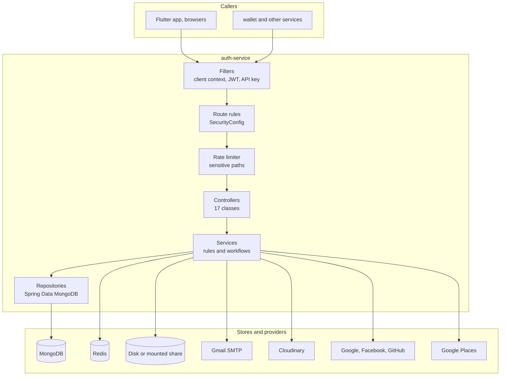
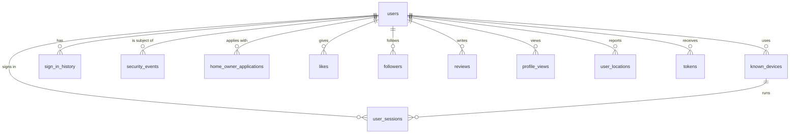

# Architecture

How the auth-service is put together, and why. Read this before you change something that crosses layers. For the settings see [CONFIGURATION.md](CONFIGURATION.md), and for the token and session rules see [AUTHENTICATION.md](AUTHENTICATION.md).

## Contents

- [The shape of it](#the-shape-of-it)
- [A request, step by step](#a-request-step-by-step)
- [The layers](#the-layers)
- [Data model](#data-model)
- [What Redis is for](#what-redis-is-for)
- [Things that run on their own](#things-that-run-on-their-own)
- [Errors](#errors)
- [Email](#email)
- [Design choices](#design-choices)

## The shape of it



The service is one Spring Boot application. Nothing is split into modules, and nothing calls another Premisave service. Other services call this one.



## A request, step by step

1. **`ClientContextFilter`** runs first. It works out the caller's address, the user agent and the device token once, and stores them on the request, so no other class parses headers. The address comes from `X-Forwarded-For` only when the request came from a proxy listed in `SECURITY_TRUSTED_PROXIES`.
2. **`JwtAuthenticationFilter`** reads `Authorization: Bearer ...`. It rejects a token that is on the Redis blacklist, ignores one that is malformed or expired (the route rules then answer 401 or 403), refuses a refresh token used as an access token, and checks that the token's session is still active. If everything holds, it puts the user into the security context.
3. **`ApiKeyFilter`** guards `/internal/**` and `/profile/public/directory`. A missing or wrong `X-API-Key` answers 401 and the request stops.
4. **The route rules** in `SecurityConfig` decide who may reach a path: public, signed in, staff or admin. The result is on the page [Who can reach what](../README.md#who-can-reach-what). A request that fails answers 401 or 403 in the same JSON shape as every other error.
5. **`RateLimiterInterceptor`** runs for a short list of sensitive paths (signup, sign in, password reset and the social write actions) and answers 429 when the bucket is empty.
6. **A controller** validates the body with Jakarta Validation, calls one service method and shapes the answer.
7. **A service** applies the rules and talks to repositories, Redis, mail, Cloudinary, the disk or a provider.
8. **`GlobalExceptionHandler`** turns any exception into the one error shape.

## The layers

| Layer | Package | Rule |
| --- | --- | --- |
| Controllers | `controller` | Validate input, call one service method, return a DTO. No business rules and no repository calls. |
| Services | `service` | Hold the rules. The only place that talks to repositories, Redis, mail, storage and providers. |
| Security services | `service/security` | Sessions, devices, throttling, risk scoring, alerts, audit and administrator provisioning. |
| Application services | `service/application` | The Home Owner workflow: the form, documents, readiness, review and emails. |
| Provider clients | `service/oauth` | One class per social provider behind one small interface. |
| Storage | `service/storage` | Where application documents live, with no business rules. |
| Places | `service/places` | The Google Places proxy that keeps the API key on the server. |
| Filters and tokens | `security` | The three filters, `JwtService` and the user details loader. |
| Configuration | `config` | Route rules, beans, startup runners and the typed settings. |
| Data | `entity`, `repository` | MongoDB documents and Spring Data repositories. |
| Types | `dto`, `enums` | What goes in and out, and the fixed vocabularies. |
| Errors | `exception` | `ApiException` and the one handler. |

## Data model

Everything is in one MongoDB database, `premisave-auth` by default. Indexes, including the TTL indexes, are created at startup by `SecurityIndexInitializer` and Spring Data.

| Collection | Holds |
| --- | --- |
| `users` | Accounts, profile fields, role, `active`, `verified` and archive flags, provider ids, audit timestamps. |
| `tokens` | Single use activation and password reset tokens, with an expiry. |
| `user_sessions` | One document per sign in: login method, device, address, user agent, generation counter, expiry and revocation. The refresh token itself is not stored. Its `gen` claim is compared with the session's current generation. |
| `known_devices` | Devices a person has signed in from. The device token is stored as a SHA-256 hash. |
| `sign_in_history` | One row per successful sign in, used for the risk score and the "recent sign ins" list. |
| `security_events` | The audit trail. Written by the service, never edited or deleted by an endpoint. |
| `security_action_tokens` | Single use tokens behind the "this was not me" and invitation links, stored hashed. |
| `home_owner_applications` | An application with its documents, timeline events and staff notes embedded. |
| `likes`, `followers`, `reviews`, `profile_views` | The social layer. |
| `user_locations` | Location history, one current entry per user. |
| `contact_messages` | Messages sent from the public contact form. |



A user can sign in only when `active` and `verified` are both true. Archived users are left out of search, discovery and the internal checks.

## What Redis is for

Redis is a helper, never the source of truth. If it is down, the service keeps working and falls back to MongoDB, with two losses: throttling stops limiting, and the token blacklist is not checked.

| Key | Purpose | Lifetime |
| --- | --- | --- |
| `blacklist:<token>` | A logged out token, so it cannot be used again. | Until the token would have expired. |
| `session active` and `session revoked` markers | A fast answer to "is this session still valid" on every request, so MongoDB is not read each time. | 60 seconds for active, the session lifetime for revoked. |
| `sec:fail`, `sec:level`, `sec:lock` for accounts and addresses | Sign in throttling. | The failure window, then the lock length. Accounts are keyed by a hash, not by the email. |
| `signup-notice:<userId>` | At most one "someone tried to register with your email" notice an hour. | One hour. |
| Contact form and resend guards | Stop mail floods. | Minutes to hours. |

## Things that run on their own

| What | When | Does |
| --- | --- | --- |
| `SecurityIndexInitializer` | Startup | Creates the indexes for the security collections. |
| `ConfiguredAdminRunner` | Startup | Creates the administrators from `ADMIN1_*` to `ADMIN3_*`. |
| `AdminProvisioningRunner` | Startup | Promotes or invites the addresses in `INITIAL_ADMIN_EMAILS`. |
| `StorageStartupCheck` | Startup | Checks the document location and logs the result. It stops startup only when `STORAGE_FAIL_ON_UNAVAILABLE=true`. |
| `SecurityRetentionJob` | Daily, `0 15 3 * * *` | Deletes audit events and devices older than the retention settings. |
| `UsernameBackfillJob` | Every five minutes | Generates a username for accounts that were created without one. |
| `@Async` work | On demand | Sends emails, uploads profile pictures to Cloudinary and generates usernames on a pool of 10 to 50 threads, so the request does not wait. |

## Errors

Almost every failure has the same shape, whether it comes from validation, a rule, the route rules or a filter. The one exception is the request rate limiter, which answers `429` with an empty body.

```json
{ "timestamp": "2026-01-15T09:30:00", "status": 400, "message": "Email already exists" }
```

Validation errors add the field messages:

```json
{ "timestamp": "2026-01-15T09:30:00", "status": 400, "errors": { "email": "must be a well-formed email address" } }
```

Rules raise `ApiException` with a status and a message that is safe to show to a person, and sometimes a `details` object. The 401 and 403 answers from the route rules carry the same fields plus `error`. Stack traces never reach the caller.

Two older paths are looser, and are worth knowing about:

- A plain `RuntimeException` answers **400** with its own message. Some rules still use it on purpose, for example "Email already exists" and "Username already taken". It also means an unexpected runtime failure shows up as a 400.
- Any other exception answers **500** with `"An unexpected error occurred"` and a `debugMessage` that holds the exception message. That field is helpful in development and should not reach the public. See [DEPLOYMENT.md](DEPLOYMENT.md).

## Email

Mail is plain SMTP through Spring Mail, on a Gmail account by default. The messages are HTML files in `src/main/resources/templates/email`, filled by a small renderer that escapes every value, so there is no template engine to configure. The set: activation, password reset, new sign in, suspicious sign in, security notice, administrator provisioned, administrator role assigned, application update, and the two contact messages. A shared `layout.html` keeps them consistent.

Mail is sent in the background. A failure is logged and recorded as a `NOTIFICATION_FAILED` event with the template name and the error class, never the address or the content, and it never changes the answer to the caller.

## Design choices

- **One identity provider.** Other services never store passwords or run a login. They check the tokens.
- **Email is the login.** `User.getUsername()` returns the email for Spring Security, so the token subject is the email. The display username is a separate field.
- **Two trust boundaries.** People authenticate with tokens, services with `X-API-Key`, in separate filters.
- **Server side sessions behind stateless tokens.** The tokens are signed, so any service can check them without a call. The session behind them is what lets this service end one, and the `sid` claim connects the two.
- **Roles come from the server.** The signup form has no role field. Roles change through configuration, the application review or an admin, and every change is audited.
- **Nothing is blocked on a guess.** A risk score only sends an email. The only automatic block is the throttling lock, which expires on its own.
- **Fail open on helpers.** Redis, mail, geolocation and the file store failing never turns a good sign in into a bad one.
- **Files on a disk you control.** Application documents never go to the database or to a third party, and are streamed back through an authorised endpoint, never a public URL.
- **One client class per provider.** Google, Facebook and GitHub each implement one small interface. A fourth provider is one more class.
