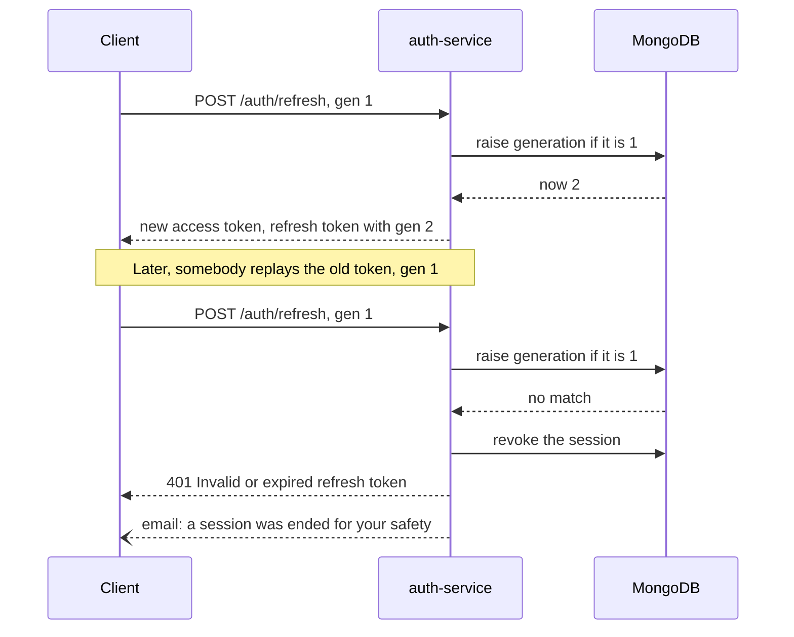

# Authentication

How people prove who they are, what they get back, and how the service keeps that safe. This is the guide to read before you write a client, or a service that trusts these tokens.

## Contents

- [The short version](#the-short-version)
- [Signing up and activating](#signing-up-and-activating)
- [Signing in](#signing-in)
- [The two tokens](#the-two-tokens)
- [Refreshing, and why a refresh token works once](#refreshing-and-why-a-refresh-token-works-once)
- [Signing out](#signing-out)
- [Sessions on the server](#sessions-on-the-server)
- [Devices](#devices)
- [Throttling](#throttling)
- [Passwords](#passwords)
- [Step-up checks](#step-up-checks)
- [What a client should do](#what-a-client-should-do)
- [Error answers](#error-answers)

## The short version



- A sign in creates a **session** on the server and returns an **access token** and a **refresh token**.
- The access token goes in `Authorization: Bearer ...` on every request.
- The refresh token goes only to `POST /auth/refresh`, which returns a new pair. Each refresh token works **once**.
- Ending the session, from a sign out, the account security page or an alert, makes both tokens stop working.

## Signing up and activating

```bash
curl -s -X POST http://localhost:8080/auth/signup -H 'Content-Type: application/json' -d '{
  "firstName": "Ada", "lastName": "Lovelace",
  "email": "you@example.com", "phoneNumber": "+10000000000",
  "password": "a long passphrase"
}'
```

| Field | Rule |
| --- | --- |
| `firstName`, `lastName`, `email`, `phoneNumber`, `password` | Required. The email must be well formed. |
| `username` | Optional, 3 to 50 letters, digits, dots, underscores or hyphens. Left out, one is generated from the name in the background. |
| `middleName`, `address1`, `address2`, `country`, `language` | Optional. `language` defaults to `ENGLISH`. |
| `role` | Not accepted. Anything sent is ignored, and every self registered account is a `CLIENT`. |

What happens:

1. The account is created, **not verified** and active, with a BCrypt hash of the password.
2. A single use activation token is stored for 24 hours and an email goes out with a link to `FRONTEND_URL/verify/<token>`.
3. By default the answer carries a session and tokens, so an app can show "check your email". The account cannot sign in again until it is verified.
4. `GET /auth/verify/{token}` verifies the account. If the address is on `AUTO_ADMIN_EMAILS`, the account becomes an administrator at this point.

`POST /auth/resend-activation` sends a new link. It answers the same way whether or not the address has an account, whether or not it is already verified, and it has per address and per client limits, so it cannot be used to find out who is registered or to flood an inbox.

**Neutral signup.** With `SECURITY_HIDE_EXISTING_ACCOUNTS=true`, signup answers `202` with the same message for a new and an existing address and returns no tokens. A new address gets its account and email, and an existing owner gets a notice, at most once an hour. Clients must then stop expecting tokens from signup. A username that is already taken is still reported, because usernames are not secret.

## Signing in

```bash
curl -s -X POST http://localhost:8080/auth/signin -H 'Content-Type: application/json' \
  -d '{"email":"you@example.com","password":"a long passphrase"}'
```

```json
{ "token": "eyJ...", "refreshToken": "eyJ...", "role": "CLIENT", "expiresIn": 2592000 }
```

`expiresIn` is the lifetime of the access token in seconds, so a client can refresh ahead of time. `deviceToken` is added for native apps, see [Devices](#devices).

In order, the service:

1. Checks the throttle for the email and for the caller's address. A locked caller gets `429` with the number of minutes to wait.
2. Checks the password. A wrong password, and an email that does not exist, give the **same** answer, `401 Invalid email or password.`, and both count as a failure.
3. Only when the password is right does it say why an account cannot sign in: `403 Account not verified. Please check your email.` or `403 Account is deactivated. Please contact support.` Someone who does not know the password learns nothing.
4. Applies a changed `AUTO_ADMIN_EMAILS` list to a verified account, so an address added to the list is promoted at its next sign in.
5. Recognises the device, scores the sign in, opens the session, records the sign in and writes the audit event.
6. Sends an alert when the rules in [ADMIN_AND_ACCOUNT_SECURITY.md](ADMIN_AND_ACCOUNT_SECURITY.md#2-testing-the-sign-in-alert) call for one, then returns the tokens.

The social providers end in the same place. See [SOCIAL_SIGN_IN.md](SOCIAL_SIGN_IN.md).

## The two tokens

Both are JWTs, signed with HS256.

| | Access token | Refresh token |
| --- | --- | --- |
| Sent to | Every API route | Only `POST /auth/refresh` |
| `sub` | The user's email | The user's email |
| `userId` | The user's id | The user's id |
| `email`, `roles` | Yes. `roles` holds one role name such as `CLIENT`. | No |
| `sid` | The session id | The session id |
| `gen` | No | The session generation it belongs to |
| `tokenType` | `access` | `refresh` |
| Lifetime | `SECURITY_ACCESS_TOKEN_MINUTES`, or `JWT_EXPIRATION` when that is 0 (about 30 days) | Until the session expires, `SECURITY_SESSION_TTL_DAYS` (30 by default) |

A refresh token used as an access token is ignored by the filter, and an access token cannot be refreshed unless the legacy path is on.

The signing key is `JWT_SECRET`, Base64 decoded and then cut or zero padded to exactly 32 bytes. Anything that checks these tokens must do the same. [INTEGRATION.md](INTEGRATION.md) has the contract.

### How long should an access token last?

By default it lasts as long as `JWT_EXPIRATION`, about 30 days, so existing clients keep working. That is convenient and weak: a revoked session stops working in this service at once, but a service that only checks the signature keeps accepting the token until it expires. Once every client stores the refresh token and calls `/auth/refresh`, set `SECURITY_ACCESS_TOKEN_MINUTES` to between 15 and 60. A revoked session then stops working everywhere within that time, because the refresh token is rejected the moment the session is revoked.

## Refreshing, and why a refresh token works once

```bash
curl -s -X POST http://localhost:8080/auth/refresh -H 'Content-Type: application/json' \
  -d '{"refreshToken":"eyJ..."}'
```

The session holds a counter, `refreshGeneration`. A refresh token carries the generation it was issued for in `gen`. On a refresh the service runs one atomic update in MongoDB: if the session is live and its generation equals the token's `gen`, raise it by one. Only one of two simultaneous callers can win, and the winner gets a new access token and a new refresh token carrying the new generation. The old refresh token is now spent.



If the update does not match, one of two things happened:

- **The session was revoked or has expired.** The caller gets `401`. A revoked session being used is recorded as a `REFRESH_TOKEN_REUSE` event.
- **An older token of a live session came back.** Somebody copied a token, or a client stored a stale one. The service records a **critical** `REFRESH_TOKEN_REUSE` event, ends the session, which also kills the newer token the real owner holds, and emails the owner. The owner signs in again.

Reuse also adds 40 points to that person's next sign in score for a day, see [ADMIN_AND_ACCOUNT_SECURITY.md](ADMIN_AND_ACCOUNT_SECURITY.md).

Because a refresh token is spent on use, a client must save the new one **before** it uses the new access token, and must not run two refreshes at once. The Flutter app does this with a single flight refresh.

**Legacy refresh.** Older clients send their access token to `/auth/refresh`. That still works while `SECURITY_LEGACY_REFRESH_ENABLED` is `true` (the default) and the token is unexpired and its session, if it has one, is live. Turn it off once every client uses refresh tokens.

## Signing out

`POST /auth/logout` with the access token in the `Authorization` header:

1. The token goes on the Redis blacklist until it would have expired.
2. The session is revoked in MongoDB, so the refresh token stops working too, and the event is audited.

A person can also end sessions from the account security page: `DELETE /security/sessions/{id}`, or `POST /security/sessions/revoke-others` to keep only the current one. Deleting a device ends its sessions as well.

## Sessions on the server

A session records the login method, the device, the address, the user agent, an approximate location when geolocation is on, the generation, the expiry and, if it ended, when, why and by whom.

On every request the filter asks "is this session still valid?". The answer comes from Redis when it can (a marker that says valid for 60 seconds, or a marker that says revoked) and from MongoDB otherwise, so revoking a session takes effect within a minute at worst on a cached read, and at once for a revocation, which writes the revoked marker.

| Reason recorded | When |
| --- | --- |
| `LOGOUT` | The person signed out. |
| `REFRESH_TOKEN_REUSE` | An old refresh token came back. Revoked by `SYSTEM`. |
| the person, or an admin | A session or device was ended from the security page, or "this was not me" was confirmed. |

Tokens issued before sessions existed have no `sid`. They keep working until they expire, and cannot be revoked one by one.

## Devices

A device is a browser or an app a person has signed in from. The first time, the service issues a random device token and stores only its SHA-256 hash.

| Client | Where the device token lives |
| --- | --- |
| Browsers | An HttpOnly cookie, `ps_did` by default. JavaScript never sees it. Needs `SECURITY_DEVICE_COOKIE_SECURE=false` on plain `http`. |
| Native apps | Send `X-Client-Platform: mobile` on sign in and the token comes back as `deviceToken` in the body. Send it on later requests as `X-Device-Token`. |

A sign in with a token the service recognises is a known device. Anything else is a new device, which feeds the alert rules and the risk score. A person can mark a device trusted (this asks for the password again), revoke its credential so it counts as new next time, or forget it. At most `SECURITY_MAX_DEVICES_PER_USER` devices are kept per person (never fewer than 5). Past that, the least recently seen device that is not trusted is removed.

A device is a good hint and not an identity. A cookie can be copied and a user agent can be faked.

## Throttling

Brute force protection runs in Redis and **fails open**: if Redis is unreachable, sign in keeps working and is simply not limited.

| Rule | Default | Effect |
| --- | --- | --- |
| Failures per account | 5 within 15 minutes | The account locks. The first lock is 15 minutes, and each repeat doubles it, up to 240 minutes. The level decays on its own. |
| Failures per address | 30 within 15 minutes | The address locks for the base lock time. |
| Accounts tried per address | 10 within 15 minutes | The same lock. This catches password spraying. |

A good sign in clears the account's failure counter. A locked caller gets `429` and the minutes to wait. When a lock starts on a real account, the owner gets an email. Accounts are keyed by a hash of the email, so unknown addresses are counted too and the keys never hold an address. All the numbers are `SECURITY_LOGIN_*` and `SECURITY_IP_*` settings, see [CONFIGURATION.md](CONFIGURATION.md#throttling).

Separately, a **rate limiter** with one shared bucket covers signup, sign in, forgot and reset password and the like, follow and review actions. See [DEPLOYMENT.md](DEPLOYMENT.md#known-limits-to-plan-around) for what that does and does not do.

## Passwords

- Stored as BCrypt hashes. An account made with a social provider gets a random password nobody knows.
- Changing a password (`POST /auth/change-password` or `POST /profile/change-password`) asks for the old one and needs at least 8 characters, with a matching confirmation. Resetting with a link needs at least 8 characters too.
- A reset link is a single use token that lasts 24 hours. `POST /auth/forgot-password` answers the same for every address. Resetting a password ends every session, changing it ends all the others, and both write an audit event and email the owner.
- **Signup does not check the strength of a password.** It only requires a value that is not blank, so enforce a minimum in your client. A server side minimum is a small change in `SignupRequest`.
- Administrators created from `ADMIN1_*` to `ADMIN3_*` have a stricter policy, described in [ADMIN_AND_ACCOUNT_SECURITY.md](ADMIN_AND_ACCOUNT_SECURITY.md).

## Step-up checks

Some changes ask for the password again even with a valid session, for example trusting a device. A wrong password there feeds the same throttle as sign in, so the check cannot be used to guess it. A session that began with a social provider in the last `SECURITY_REAUTH_WINDOW_MINUTES` (10) counts as fresh, because those accounts usually have no password to type. An older social session is asked to sign in again.

## What a client should do

1. Store both tokens. Prefer the platform's secure storage, and never put them in a URL.
2. Send the access token on every call. When `expiresIn` says it is close to expiry, or a call returns `401`, refresh once and retry the call once.
3. Save the new refresh token before anything else, and run only one refresh at a time.
4. If the refresh answers `401`, the session is over: clear the tokens and go to sign in.
5. Send `X-Client-Platform: mobile` from a native app and keep the `deviceToken`, so the device is recognised next time.
6. For a browser, send credentials with requests so the device cookie travels, and read the "this was not me" page rules in [ADMIN_AND_ACCOUNT_SECURITY.md](ADMIN_AND_ACCOUNT_SECURITY.md).

## Error answers

| Status | Meaning here |
| --- | --- |
| `400` | Invalid input, or a rule such as "Email already exists". Field errors come back under `errors`. |
| `401` | No valid sign in, a wrong email or password, a revoked session, or a refresh token that is not current. |
| `403` | Signed in but not allowed, an account that is not verified or is deactivated, or a step-up check that failed. |
| `409` | A state conflict, for example an application that is already closed. |
| `429` | Locked for too many failed sign ins, or the rate limiter's bucket is empty. |

All of them use the JSON shape in [ARCHITECTURE.md](ARCHITECTURE.md#errors).
