<!-- band -->

# Configuration

Every setting of the auth-service, with its default and what it does. All of them come from environment variables, which `application.yml` reads. For local work you put them in a `.env` file, and `.env.example` is a commented template.

## Contents

- [How settings are loaded](#how-settings-are-loaded)
- [Required](#required)
- [Addresses](#addresses)
- [Data stores](#data-stores)
- [Mail and profile pictures](#mail-and-profile-pictures)
- [Tokens](#tokens)
- [Social sign in](#social-sign-in)
- [Administrators](#administrators)
- [Sessions and devices](#sessions-and-devices)
- [Alerts](#alerts)
- [Throttling](#throttling)
- [Risk scoring](#risk-scoring)
- [Network and location](#network-and-location)
- [Retention](#retention)
- [Home Owner applications](#home-owner-applications)
- [Document storage](#document-storage)
- [Places](#places)
- [Things that are not settings](#things-that-are-not-settings)

## How settings are loaded

1. On startup the service looks for a `.env` file **in the folder you start it from**, and copies every entry into the Java system properties. Spring then reads them like any other property. No `.env` is fine.
2. A value can instead come from a real environment variable, which is the right choice on a server, in Docker and in CI.
3. Every `${NAME:default}` in `application.yml` falls back to the default shown below when nothing is set. The six [required](#required) settings have no default.
4. Settings are read once, at startup. Change one, then restart.
5. Write values without quotes and without trailing spaces. A boolean is `true` or `false`. A list is separated by commas.
6. Do not set the same key in both `.env` and the real environment with different values. It works, but it makes the running value hard to know.

`application.yml` holds three things that are **not** environment variables: `server.port` (8080), the multipart limit (10 MB per file and per request) and the logging levels. See [Things that are not settings](#things-that-are-not-settings).

## Required

The service refuses to start without these six. That is on purpose, so a forgotten secret can never fall back to a public default.

| Variable | What it is |
| --- | --- |
| `JWT_SECRET` | The key that signs every token. Base64, at least 32 bytes once decoded: `openssl rand -base64 32`. Every service that checks these tokens needs the same value. |
| `API_KEY` | The key other services send as `X-API-Key`. `openssl rand -hex 32`. The wallet service names it `INTERNAL_API_KEY`. |
| `GMAIL_PASSWORD` | A Gmail App Password for the sending account. |
| `CLOUDINARY_CLOUD_NAME` | From the Cloudinary dashboard. |
| `CLOUDINARY_API_KEY` | From the Cloudinary dashboard. |
| `CLOUDINARY_API_SECRET` | From the Cloudinary dashboard. |

Two more have defaults that are **not yours**, so set them: `GMAIL_USERNAME` and `SUPPORT_EMAIL`. See [Mail and profile pictures](#mail-and-profile-pictures).

## Addresses

| Variable | Default | What it does |
| --- | --- | --- |
| `FRONTEND_URL` | `http://localhost:3000` | Where the app runs. Every link in an email starts with this. No trailing slash. |
| `BACKEND_URL` | `http://localhost:8080` | This service's public address. |
| `SECURITY_PAGE_PATH` | `/account/security` | The page in the app that lists devices and sessions. Emails link to it. |
| `HOME_OWNER_FRONTEND_PATH` | `/home-owner/application` | The page in the app for the Home Owner application. Emails link to it. |

## Data stores

| Variable | Default | What it does |
| --- | --- | --- |
| `MONGODB_URI` | `mongodb://localhost:27017/premisave-auth` | The connection string. The database name is the last part of the path. Add credentials and `?authSource=` for a secured server, or use an Atlas `mongodb+srv://` string. |
| `REDIS_HOST` | `localhost` | Redis host. |
| `REDIS_PORT` | `6379` | Redis port. There is no dedicated setting for a Redis password in this file, so keep Redis on a private network. |

## Mail and profile pictures

| Variable | Default | What it does |
| --- | --- | --- |
| `MAIL_HOST` | `smtp.gmail.com` | SMTP host. The connection always uses STARTTLS. |
| `MAIL_PORT` | `587` | SMTP port. |
| `GMAIL_USERNAME` | a developer address | The sender. **Set this.** It must be the account that issued the App Password. |
| `GMAIL_PASSWORD` | none | The App Password. A normal Gmail password does not work. Create it under Google Account, Security, 2-step verification, App passwords. |
| `SUPPORT_EMAIL` | a developer address | The address people are told to write to in emails. **Set this.** |
| `CLOUDINARY_CLOUD_NAME`, `CLOUDINARY_API_KEY`, `CLOUDINARY_API_SECRET` | none | Profile pictures, including the ones imported at social sign in, are uploaded here. |

A mail failure never fails the request. It is logged and recorded as a `NOTIFICATION_FAILED` event.

## Tokens

| Variable | Default | What it does |
| --- | --- | --- |
| `JWT_EXPIRATION` | `2592000000` | Access token lifetime in milliseconds, about 30 days. Used only when `SECURITY_ACCESS_TOKEN_MINUTES` is 0. |
| `SECURITY_ACCESS_TOKEN_MINUTES` | `0` | Access token lifetime in minutes. `0` keeps `JWT_EXPIRATION`. **Use 15 to 60 in production** once your clients refresh. A shorter token is what makes an ended session stop working in services that only check the signature. |
| `SECURITY_LEGACY_REFRESH_ENABLED` | `true` | Lets older clients send an unexpired access token to `POST /auth/refresh`. Turn it off once every client sends the refresh token. |
| `SECURITY_SESSION_TTL_DAYS` | `30` | How long a session, and so its refresh token, lasts. |
| `SECURITY_REAUTH_WINDOW_MINUTES` | `10` | How long a fresh social sign in counts as proof of identity for sensitive actions. |
| `SECURITY_HIDE_EXISTING_ACCOUNTS` | `false` | `true` makes `POST /auth/signup` answer `202` with the same message whether or not the email is taken, issues no tokens, and tells the existing owner by email. |

How these fit together: [AUTHENTICATION.md](AUTHENTICATION.md).

## Social sign in

Every provider is optional. Leave its variables out and that provider answers "not configured". Details and console steps: [SOCIAL_SIGN_IN.md](SOCIAL_SIGN_IN.md).

| Variable | Default | What it does |
| --- | --- | --- |
| `GOOGLE_CLIENT_ID` | empty | One or more OAuth client IDs, comma separated. A token issued to any of them is accepted. |
| `GOOGLE_CLIENT_SECRET` | empty | Only for sign in by authorization code (desktop). |
| `GOOGLE_CODE_CLIENT_ID` | empty | The Web client a code was issued to. Empty means the first `GOOGLE_CLIENT_ID`. |
| `FACEBOOK_APP_ID`, `FACEBOOK_APP_SECRET` | empty | Both are needed. |
| `GITHUB_CLIENT_ID`, `GITHUB_CLIENT_SECRET` | empty | Both are needed. |
| `OAUTH_ALLOWED_REDIRECT_URIS` | `http://localhost:3000/auth.html` | The only redirect addresses a client may use with an authorization code. Comma separated, matched exactly. |

## Administrators

How administrators come to exist, and why the invitation route is the safer one: [ADMIN_AND_ACCOUNT_SECURITY.md](ADMIN_AND_ACCOUNT_SECURITY.md).

| Variable | Default | What it does |
| --- | --- | --- |
| `INITIAL_ADMIN_EMAILS` | empty | Provisioned at startup. A verified account is promoted. An address with no account gets one and an invitation email. |
| `AUTO_ADMIN_EMAILS` | empty | An account with one of these addresses becomes `ADMIN` once its email is verified, at sign up, sign in or social sign in. |
| `SECURITY_INVITATION_TTL_HOURS` | `72` | How long an administrator invitation link works. |
| `ADMINS_ENABLED` | `true` | Turns the `ADMINn_*` slots on or off. |
| `ADMINS_STRICT` | `false` | `true` stops startup when a slot is invalid. `false` skips it and logs why. |
| `ADMINS_PROMOTE_EXISTING` | `false` | `true` promotes an existing verified, active account that has the slot's email. `false` leaves it alone and logs a warning. |
| `ADMINS_MIN_PASSWORD_LENGTH` | `8` | Minimum length for a slot's password. Never lower than 8. |
| `ADMIN1_*`, `ADMIN2_*`, `ADMIN3_*` | empty | For each slot: `EMAIL` (needed), `USERNAME`, `FIRST_NAME`, `MIDDLE_NAME`, `LAST_NAME`, `PASSWORD`. A slot with no values is unused. An account is only ever created here. Nothing is overwritten and nobody is demoted. After the first sign in, change the password and delete it from `.env`. |

Removing an address from these lists never demotes an administrator. Use `PUT /admin/users/change-role/{id}`, which is audited.

## Sessions and devices

| Variable | Default | What it does |
| --- | --- | --- |
| `SECURITY_DEVICE_TRUST_ENABLED` | `true` | Lets people mark a device trusted. When off, those endpoints answer `403`. |
| `SECURITY_SESSION_REVOCATION_ENABLED` | `true` | Lets people end sessions and forget devices. When off, those endpoints answer `403`. |
| `SECURITY_DEVICE_COOKIE_NAME` | `ps_did` | The remembered device cookie. |
| `SECURITY_DEVICE_COOKIE_SECURE` | `true` | Sends the cookie only over HTTPS. Set `false` for plain `http` on localhost, or every sign in looks like a new device. |
| `SECURITY_DEVICE_COOKIE_SAME_SITE` | `Lax` | `Lax`, `Strict` or `None`. A front end on a different site needs `None`, which also needs `Secure`. |
| `SECURITY_DEVICE_COOKIE_MAX_AGE_DAYS` | `365` | How long a browser is remembered. |
| `SECURITY_MAX_DEVICES_PER_USER` | `50` | When reached, the least recently seen untrusted device is removed to make room. The effective minimum is 5. |

## Alerts

| Variable | Default | What it does |
| --- | --- | --- |
| `SECURITY_LOGIN_EMAIL_NOTIFICATIONS` | `true` | Sends "new sign in" emails. |
| `SECURITY_NEW_DEVICE_ALERTS` | `true` | Treats a new device as a signal, and emails about it. |
| `SECURITY_SUSPICIOUS_LOGIN_ALERTS` | `true` | Sends the suspicious sign in email when the risk score reaches the threshold. |
| `SECURITY_DEVICE_ALERT_COOLDOWN_HOURS` | `24` | At most one alert for the same device in this time. |
| `SECURITY_ALERT_FIRST_DEVICE` | `false` | `false` skips the alert for a person's very first device, which is just them signing up. |
| `SECURITY_DISPLAY_ZONE` | `UTC` | The time zone used for times written in emails, for example `Africa/Nairobi`. |
| `SECURITY_ACTION_TOKEN_TTL_MINUTES` | `1440` | How long the "this was not me" link works. |

## Throttling

Two separate limits protect the sensitive endpoints.

**Sign in throttling** counts wrong passwords, per account and per address, in Redis. It locks for a while, and the lock doubles each time up to a cap. It expires on its own and never needs an administrator.

| Variable | Default | What it does |
| --- | --- | --- |
| `SECURITY_LOGIN_MAX_FAILURES` | `5` | Failures for one account before it locks. |
| `SECURITY_LOGIN_FAILURE_WINDOW_MINUTES` | `15` | The window those failures are counted in. |
| `SECURITY_LOGIN_LOCKOUT_MINUTES` | `15` | The first lock length. |
| `SECURITY_LOGIN_MAX_LOCKOUT_MINUTES` | `240` | The longest lock. |
| `SECURITY_IP_MAX_FAILURES` | `30` | Failures from one address before it locks. |
| `SECURITY_IP_MAX_DISTINCT_ACCOUNTS` | `10` | Different accounts tried from one address before it locks. |
| `SECURITY_IP_WINDOW_MINUTES` | `15` | The window for both address limits. |

**The request rate limiter** is a Bucket4j bucket held in memory.

| Variable | Default | What it does |
| --- | --- | --- |
| `RATE_LIMIT_REQUESTS_PER_MINUTE` | `20` | Requests per minute across `POST /auth/signup`, `/auth/signin`, `/auth/reset-password`, `/auth/forgot-password`, `/social/like`, `/social/follow` and `/social/review`. |

That bucket is **one for the whole service**, not one per caller, and it lives in the memory of one instance. Heavy traffic from one person can use up everyone's allowance, and running two instances doubles it. It is a safety net, not a per caller limit. The sign in throttling above is the real brute force protection. See [Known limits to plan around](DEPLOYMENT.md#known-limits-to-plan-around).

## Risk scoring

A sign in is scored from signals, and an alert is sent when the total reaches the threshold. Nothing is ever blocked from a score. The weights are fixed in code: new device 20 (35 for an administrator), country change 40, high frequency 25, many addresses 30, recent failures 35, refresh token reuse 40.

| Variable | Default | What it does |
| --- | --- | --- |
| `SECURITY_RISK_ALERT_THRESHOLD` | `50` | The score that triggers the alert. With these weights, one signal alone never does. |
| `SECURITY_LOCATION_CHANGE_WINDOW_HOURS` | `12` | A country change inside this window counts. |
| `SECURITY_FREQUENCY_THRESHOLD` | `8` | Sign ins in the window that count as high frequency. |
| `SECURITY_FREQUENCY_WINDOW_MINUTES` | `10` | That window. |
| `SECURITY_DISTINCT_IP_THRESHOLD` | `4` | Different addresses in the window that count as many. |
| `SECURITY_DISTINCT_IP_WINDOW_MINUTES` | `60` | That window. |

## Network and location

| Variable | Default | What it does |
| --- | --- | --- |
| `SECURITY_TRUSTED_PROXIES` | empty | Addresses or CIDR ranges, comma separated, whose `X-Forwarded-For` is believed. Leave it empty if the service is reached directly. **Behind a load balancer, set it**, or every person appears to come from the balancer and throttling and scoring stop working. |
| `SECURITY_IP_GEOLOCATION_ENABLED` | `false` | Looks up an approximate country and city for each sign in. Off by default because it sends visitor addresses to the lookup service. |
| `SECURITY_IP_GEOLOCATION_URL` | `https://ipwho.is/{ip}` | The lookup service. `{ip}` is replaced. |
| `SECURITY_IP_GEOLOCATION_TIMEOUT_MS` | `2000` | A slow lookup is dropped, and the sign in goes on without it. |

Country change scoring needs geolocation, see [ADMIN_AND_ACCOUNT_SECURITY.md](ADMIN_AND_ACCOUNT_SECURITY.md#3-geolocation-proxies-and-mfa).

## Retention

| Variable | Default | What it does |
| --- | --- | --- |
| `SECURITY_AUDIT_RETENTION_DAYS` | `180` | Audit events older than this are deleted. |
| `SECURITY_DEVICE_RETENTION_DAYS` | `365` | Devices not seen for this long are deleted. |
| `SECURITY_RETENTION_CRON` | `0 15 3 * * *` | When the clean up runs, as a Spring cron with seconds. The default is 03:15 every day. |

## Home Owner applications

Rules and flow: [HOME_OWNER_APPLICATIONS.md](HOME_OWNER_APPLICATIONS.md).

| Variable | Default | What it does |
| --- | --- | --- |
| `HOME_OWNER_MAX_FILE_SIZE_MB` | `8` | The largest document. **The server's own upload limit is 10 MB**, so a value above 10 has no effect. |
| `HOME_OWNER_MAX_DOCUMENTS` | `25` | Documents per application. |
| `HOME_OWNER_REVIEW_SLA_DAYS` | `3` | The number of working days shown to applicants as the usual review time. It is a message, not a timer, and nothing is escalated when it passes. |
| `HOME_OWNER_MAX_REAPPLICATIONS` | `3` | How often a rejected application may be reopened. `0` turns reapplying off. |

## Document storage

Where the uploaded files live, and how to set up a NAS: [STORAGE.md](STORAGE.md). Nothing here is needed to start.

| Variable | Default | What it does |
| --- | --- | --- |
| `STORAGE_TYPE` | `LOCAL` | `LOCAL` or `NETWORK`. |
| `STORAGE_CREATE_DIRECTORIES` | `true` | Creates the folders when they are missing. |
| `STORAGE_FAIL_ON_UNAVAILABLE` | `false` | `true` stops startup when the location is unusable. `false` starts anyway and uploads answer `503` until it is fixed. |
| `STORAGE_MIN_FREE_MB` | `100` | Uploads are refused when less than this is free. `0` turns the check off. |
| `STORAGE_LOCAL_PATH` | empty | The folder for `LOCAL`. Empty means `~/premisave-file-storage/homeowner-onboarding` in the home folder of the user running the service. |
| `STORAGE_NETWORK_PROTOCOL` | `SMB` | `SMB` or `NFS`. |
| `STORAGE_NETWORK_HOST` | empty | The NAS address. Used to check that the right share is mounted, never to connect. |
| `STORAGE_NETWORK_SHARE` | empty | The SMB share name, or the NFS exported path. |
| `STORAGE_NETWORK_MOUNT_PATH` | `/mnt/premisave-nas` | Where the operating system mounts it. |
| `STORAGE_NETWORK_DIRECTORY` | `homeowner-onboarding` | The folder inside the share. |
| `STORAGE_NETWORK_REQUIRE_MOUNT` | `true` | Refuses to write unless the share is really mounted. Without it, files would quietly land on the local disk. |

## Places

Address search for the apps. The Google key stays on the server.

| Variable | Default | What it does |
| --- | --- | --- |
| `GOOGLE_MAPS_API_KEY` | empty | With a key, `/places/*` uses Google Places and Geocoding. Without one, `GET /places/status` says `enabled: false` and the apps use the free OpenStreetMap search. |
| `PLACES_TIMEOUT_MS` | `4000` | How long to wait for Google. |
| `PLACES_REQUESTS_PER_USER_PER_MINUTE` | `90` | One account cannot make more Google calls than this per minute, which protects your bill. |

In Google Cloud, enable **Places API (New)** and **Geocoding API**, turn on billing, create a key, and restrict it to those two APIs and to this server's IP address.

## Things that are not settings

These are in `application.yml` itself. Change the file, rebuild, and restart.

| Setting | Value | Notes |
| --- | --- | --- |
| `server.port` | `8080` | Fixed. Put a reverse proxy in front for another port. |
| `spring.servlet.multipart.max-file-size` and `max-request-size` | `10MB` | The upload ceiling for every endpoint. |
| `profile-views.max-history-size` | `20` | How many entries `GET /profile/views/who-i-viewed` returns. |
| `logging.level` for `com.premisave.auth` and `org.springframework.data.mongodb` | `DEBUG` | Right for development, too chatty for production. Set it to `INFO` before you deploy. |

CORS allows every origin. That is convenient while building and is listed in [DEPLOYMENT.md](DEPLOYMENT.md) as something to close before production.
