<!-- band -->
<div align="center">



[](#run-in-docker)
[](#behind-a-reverse-proxy)
[](#before-you-go-live)
[](https://github.com/peacemakerbill/premisave_auth_service/commits/main/docs/DEPLOYMENT.md)

</div>

# Deployment

How to put the auth-service on a server, and what to close first. Running it locally needs none of this. Running it for real people does.

## Contents

- [Before you go live](#before-you-go-live)
- [Build](#build)
- [Run as a service](#run-as-a-service)
- [Run in Docker](#run-in-docker)
- [Behind a reverse proxy](#behind-a-reverse-proxy)
- [Running more than one instance](#running-more-than-one-instance)
- [Monitoring](#monitoring)
- [Backups](#backups)
- [Upgrading](#upgrading)
- [Known limits to plan around](#known-limits-to-plan-around)




## Before you go live

Work through this list once. Each line says what to do and why.

**Secrets**

- [ ] **Generate fresh secrets** for `JWT_SECRET` and `API_KEY`. Never reuse a development value, and never one that was ever committed, pasted in a chat, or sent by email.
- [ ] **Rotate anything that was exposed** during development: the Gmail App Password, the Cloudinary secret, the Google, Facebook and GitHub client secrets, and the Maps key.
- [ ] Keep secrets in the server's environment or a secret manager. Do not ship a `.env` inside an image.

**Tokens and sessions**

- [ ] **Set `SECURITY_ACCESS_TOKEN_MINUTES` to 15 to 60.** The default is a 30 day access token, which means a stolen token works for a month, and ending a session does not stop it in other services. See [INTEGRATION.md](INTEGRATION.md#ending-a-session-across-services).
- [ ] Set `SECURITY_LEGACY_REFRESH_ENABLED=false` once every client sends the refresh token.
- [ ] Keep `SECURITY_DEVICE_COOKIE_SECURE=true` and serve everything over **HTTPS**.
- [ ] Consider `SECURITY_HIDE_EXISTING_ACCOUNTS=true`, so sign up does not reveal which emails are registered.

**Network**

- [ ] **Restrict CORS.** It currently allows every origin. In `SecurityConfig.corsConfigurationSource()` replace `setAllowedOriginPatterns(List.of("*"))` with your real front end addresses.
- [ ] **Restrict `/internal/**` and `/profile/public/directory`** at the network to your own services. The API key is the only other check.
- [ ] Set `SECURITY_TRUSTED_PROXIES` to your proxy or load balancer, so sign in throttling and risk scoring see the real caller address.
- [ ] Keep MongoDB and Redis on a private network, with authentication on MongoDB.

**Output**

- [ ] **Remove `debugMessage` from 500 answers.** `GlobalExceptionHandler` includes the exception message in the body of an unexpected error. It helps in development and can leak internals in production.
- [ ] **Set logging to `INFO`.** `application.yml` ships `DEBUG` for `com.premisave.auth` and for Spring Data MongoDB. Change the two levels in the file, or set `LOGGING_LEVEL_COM_PREMISAVE_AUTH=INFO` and `LOGGING_LEVEL_ORG_SPRINGFRAMEWORK_DATA_MONGODB=INFO` in the environment.

**Accounts**

- [ ] Set `GMAIL_USERNAME` and `SUPPORT_EMAIL`. The defaults in `application.yml` are a developer's own address, and people would see it in emails.
- [ ] Set `FRONTEND_URL` to the public address of the app. Every email link is built from it.
- [ ] Create administrators with `INITIAL_ADMIN_EMAILS`, which sends an invitation, rather than putting a password in `ADMINn_PASSWORD`. If you did use `ADMINn_*`, change that password after the first sign in and remove it.
- [ ] Add your production redirect addresses to `OAUTH_ALLOWED_REDIRECT_URIS` and remove the `localhost` one.
- [ ] Put your production domains, and the release signing SHA-1 for Android, on the Google, Facebook and Maps keys.

**Hygiene**

- [ ] Delete the committed `bin/` folder, an IDE build copy that was added by mistake, and add `bin/` to `.gitignore`.
- [ ] Back up MongoDB and the document storage together, see [Backups](#backups).

## Build

```bash
sh ./mvnw -q -DskipTests package
ls target/premisave_auth_service-0.0.1-SNAPSHOT.jar
```

The jar is self contained, and needs Java 21. Build in CI and deploy the jar, rather than building on the server.

## Run as a service

On a Linux server with `systemd`. Put the settings in a file only the service user can read, and not in the unit itself.

```ini
# /etc/systemd/system/premisave-auth.service
[Unit]
Description=Premisave auth-service
After=network-online.target mongod.service redis.service
Wants=network-online.target

[Service]
User=premisave
WorkingDirectory=/opt/premisave-auth
EnvironmentFile=/etc/premisave/auth.env
ExecStart=/usr/bin/java -Xms256m -Xmx512m -jar /opt/premisave-auth/premisave_auth_service.jar
Restart=on-failure
RestartSec=5
NoNewPrivileges=true

[Install]
WantedBy=multi-user.target
```

```bash
sudo install -m 600 -o premisave /dev/null /etc/premisave/auth.env   # then fill it in as KEY=value lines
sudo systemctl daemon-reload
sudo systemctl enable --now premisave-auth
journalctl -u premisave-auth -f
```

`EnvironmentFile` lines are plain `KEY=value`, with no quotes. The service starts only when the six [required settings](CONFIGURATION.md#required) are present, and the log says which one is missing.

## Run in Docker

The repository ships a `Dockerfile`, a compose file per environment, and files for Render, Coolify, Heroku,
Fly.io and Railway. The full guide, with development, staging and production, is in
[deploy/README.md](../deploy/README.md).

```bash
docker compose up --build        # development: the service with its own MongoDB and Redis, on :8080
docker compose down              # stop it, the data stays
```

The main [README](../README.md#run-it-with-docker-and-deploy-it) explains every environment with pictures: development,
staging on a server, production with a version tag, publishing the image, and each hosting platform. `deploy/env/from-dotenv.sh`
builds the staging or production settings file from the `.env` you already use.

Two things to get right in a container:

- **Mount the document folder as a volume.** The image keeps documents in `/data`; without a volume they vanish
  with the container. For a NAS, mount the share on the **host** and bind it into the container, see [STORAGE.md](STORAGE.md).
- Point `MONGODB_URI` and `REDIS_HOST` (or `SPRING_DATA_REDIS_URL`) at services the container can reach.
  `localhost` inside a container is the container itself.

## Behind a reverse proxy

Terminate HTTPS at a proxy such as nginx, and pass the caller's address on:

```nginx
server {
    listen 443 ssl;
    server_name auth.example.com;

    client_max_body_size 12m;

    location / {
        proxy_pass         http://127.0.0.1:8080;
        proxy_set_header   Host $host;
        proxy_set_header   X-Forwarded-For $remote_addr;
        proxy_set_header   X-Forwarded-Proto $scheme;
    }

    # service to service calls only
    location /internal/ {
        allow 10.0.0.0/8;
        deny  all;
        proxy_pass http://127.0.0.1:8080;
        proxy_set_header X-Forwarded-For $remote_addr;
    }
}
```

Set `X-Forwarded-For` to `$remote_addr` rather than appending to what the client sent, so the value cannot be forged. Then list the proxy's address in `SECURITY_TRUSTED_PROXIES`. The service believes `X-Forwarded-For` only from addresses on that list. `client_max_body_size` should be a little above the 10 MB upload ceiling.

If the proxy and the service are on the same machine, the proxy address is `127.0.0.1`.

## Running more than one instance

The service keeps its state in MongoDB and Redis, so instances can sit behind a load balancer and share the work. These points matter:

- **Every instance needs the same `JWT_SECRET`, `API_KEY` and database settings.**
- **The request rate limiter is per instance**, and is one shared bucket per instance. Two instances give twice the allowance. Sign in throttling is in Redis, so it is shared and unaffected.
- **Startup jobs run on every instance.** Administrator provisioning, index creation, the daily retention clean up and the username backfill are written to be repeatable. The first time you create administrators, start one instance first and the others after it, so two never create the same account at once.
- **Document storage must be shared.** A `LOCAL` folder is private to one machine, so use a network share mounted at the same path on every instance.

## Monitoring

- `GET /health` tells a load balancer the process is alive. It is a fixed answer. It does **not** check MongoDB, Redis or mail, so a broken database still reports `UP`. For a real check, also watch the log, and run a synthetic sign in from your monitoring.
- Watch for `NOTIFICATION_FAILED` events (mail is failing), `REFRESH_TOKEN_REUSE` (a stolen token was replayed), repeated `429` answers (an attack, or a broken client), and `503` on uploads (storage).
- Security events are in the `security_events` collection and at `GET /admin/security/events`.
- Keep logs out of public reach. At `DEBUG` they are detailed.

## Backups

- **MongoDB**, on a schedule, with a restore you have actually tried.
- **The document storage folder**, taken at the same time. A record without its file, or a file without its record, is a broken application.
- Redis needs no backup. Everything in it is rebuilt, though everyone's throttle counters reset.
- Keep the secrets in your secret manager, so a rebuilt server gets the **same** `JWT_SECRET`. A new one signs everybody out.

## Upgrading

1. Build the new jar and read the changes for new settings. New settings all have safe defaults.
2. Deploy to one instance and watch `/health` and the log.
3. Indexes are created at startup and need no manual migration.
4. Roll back by redeploying the previous jar. Read the change list first, because a release that adds fields or indexes should be checked for whether the older jar still reads them.

## Known limits to plan around

These are real, and are listed so nothing surprises you.

| Limit | Effect | What to do |
| --- | --- | --- |
| **One shared rate limit bucket.** The request limiter is a single in memory bucket for all callers, not one per address. | One noisy caller can use up the allowance for everyone on those paths, and each instance has its own. | Rely on the per account and per address sign in throttling in Redis for brute force protection, and add per address limits at the proxy. |
| **Redis fails open.** If Redis is down, the service keeps working. | Sign in throttling stops limiting, and logged out tokens are not checked against the blacklist until Redis returns. | Monitor Redis, and keep access tokens short. |
| **`/health` is static.** | A failing database still answers `UP`. | Add a real dependency check in your monitoring. |
| **30 day access tokens by default.** | A leaked token lasts a month. | Set `SECURITY_ACCESS_TOKEN_MINUTES`. |
| **Signup has no password minimum.** `SignupRequest` only requires a non blank value. | A person can register with a one character password. Change and reset do require 8. | Enforce a minimum in your client, or add `@Size(min = 8)` to the field. |
| **500 answers carry `debugMessage`.** | An unexpected error shows its message to the caller. | Remove the field before production. |
| **A plain `RuntimeException` answers 400.** | A few rules, and any unexpected runtime failure, show up as 400 rather than 500. | Treat a 400 with an odd message as a possible bug. |
| **CORS is open to every origin, with credentials allowed.** | Any website can call the API from a browser, and the browser sends the remembered device cookie with it. Tokens travel in headers, which limits the harm, but a page you do not control should not be able to try. | Restrict it to your front end addresses. |
| **No Redis password setting.** | Redis is expected to be private. | Use a private network. Spring's standard `SPRING_DATA_REDIS_PASSWORD` should also work, but has not been tried here. |
| **`/swagger-ui/**`, `/v3/api-docs/**` and `/test/**` are permitted** by `SecurityConfig`, but no Swagger library or test controller exists. | Nothing is exposed today. A future controller on those paths would be public without anyone deciding so. | Remove the three permit rules. |
| **Two unused dependencies**, `spring-boot-starter-amqp` and `bucket4j_jdk17-lettuce`. | A larger jar, and a larger surface to patch. | Remove them from `pom.xml` if you are sure nothing needs them. |
| **Tests.** One test, which checks that the application context starts. | A regression in a rule is caught by hand, not by a build. | Add tests before changing the security rules, see [DEVELOPMENT.md](DEVELOPMENT.md). |
| **Local file storage is per machine.** | A second instance cannot see the first one's documents. | Use a network share. |
