# Home Owner applications

A new account is a `CLIENT`. A person who owns or manages property applies to become a `HOME_OWNER`. The auth-service holds the whole workflow: the form, the documents, the review, the emails, and the final promotion that changes the role.



## Contents

- [Who does what](#who-does-what)
- [The life of an application](#the-life-of-an-application)
- [The form](#the-form)
- [Documents](#documents)
- [Review](#review)
- [Promotion](#promotion)
- [Emails](#emails)
- [Limits and settings](#limits-and-settings)
- [Calling it from a client](#calling-it-from-a-client)

## Who does what

| Person | Can |
| --- | --- |
| Applicant (`CLIENT`) | Start, fill in, upload, submit, resubmit when asked, reapply after a rejection, withdraw, delete an unsent draft. |
| Staff (`ADMIN`, `OPERATIONS`, `FINANCE`, `SUPPORT`) | Search, claim, review documents, ask for information, reject, add private notes, mark verified. |
| Administrator | All of that, plus assign to someone else, reopen a rejected application, and **promote**. |

Nobody can reach another applicant's application. A request for someone else's record answers `404`, the same as one that does not exist.

An account that is already a `HOME_OWNER`, or a staff account, cannot apply. A person can have one open application at a time.

## The life of an application

| Status | Label shown | Meaning |
| --- | --- | --- |
| `DRAFT` | Draft | Being filled in. Only the applicant can see it. |
| `SUBMITTED` | Submitted | Waiting for a reviewer. |
| `PROCESSING` | In review | A reviewer is checking it. |
| `INFO_REQUESTED` | Action needed | The reviewer needs something. The applicant fixes it and resubmits. |
| `VERIFIED` | Verified | Details and every required document are confirmed. Waiting for an administrator. |
| `ACCEPTED` | Accepted | Promoted. Final. |
| `REJECTED` | Not approved | Closed with a reason. May be reopened by the applicant, see below. |
| `WITHDRAWN` | Withdrawn | Cancelled by the applicant. Final. |

The applicant may edit only in `DRAFT` and `INFO_REQUESTED`.

**Applicant moves**

- Submit from `DRAFT` or `INFO_REQUESTED`. The form must be complete and every required document present, or the answer is `422` with a list of what is missing.
- Withdraw from any state that is not final.
- Reapply from `REJECTED`. The application goes back to `INFO_REQUESTED`, with the rejection reason as the message. This works up to `HOME_OWNER_MAX_REAPPLICATIONS` times (3 by default), and not at all when the reviewer closed it for good, or when another application is already open.
- Delete only a draft that was never submitted.

**Reviewer moves** (`POST /staff/applications/{id}/status`)

| From | To |
| --- | --- |
| `SUBMITTED` | `PROCESSING`, `INFO_REQUESTED`, `REJECTED` |
| `PROCESSING` | `INFO_REQUESTED`, `VERIFIED`, `REJECTED` |
| `INFO_REQUESTED` | `REJECTED` |
| `VERIFIED` | `PROCESSING`, `INFO_REQUESTED`, `REJECTED` |
| `REJECTED` | `PROCESSING`, administrator only, and only when the applicant has no other open application |

Rules that go with these moves:

- `INFO_REQUESTED` and `REJECTED` need a message. The applicant sees it and it is emailed.
- `VERIFIED` is refused until the form is complete and every required document is verified.
- A reviewer cannot set `ACCEPTED`. Only promotion does.
- On `REJECTED`, `allowReapply: false` closes the application for good, for example after a failed identity check. The person can still start a brand new application.
- Claiming a `SUBMITTED` application moves it to `PROCESSING`.

Every change is written to the application's timeline with who did it and when. A person sees the events meant for them. Staff see internal ones too.

## The form

Application numbers look like `HOA-2026-000123`. They count up per year.

| Group | Fields |
| --- | --- |
| Who is applying | `ownerType` (`INDIVIDUAL`, `COMPANY`, `PROPERTY_MANAGER`), and for a company `companyName`, `companyRegistrationNumber` |
| Identity | `idType`, `idNumber`, `idIssuingCountry`, `dateOfBirth` (18 or older), `nationality`, `taxId` |
| Contact | `phoneNumber`, `alternatePhoneNumber`, `country`, `region`, `city`, `physicalAddress`, `postalAddress` |
| Property | `numberOfProperties`, `estimatedTotalUnits`, `propertyTypes`, `primaryPropertyLocation`, `propertyDescription`, `managementPreference`, `yearsAsLandlord` |
| Payout | `payoutMethod`, then by method: mobile money (`mobileMoneyProvider`, `mobileMoneyNumber`), PayPal (`paypalEmail`), or bank (`bankName`, `bankAccountName`, `bankAccountNumber`, `bankSwiftCode`, `bankBranch`) |
| About | `motivation`, `referralSource` |
| Consent | `termsAccepted`, `privacyConsent`, `declarationAccepted`, all three required |

`GET /home-owner/applications/meta` returns the choices for every drop down, with their labels, so a client never hardcodes them.

`PATCH` saves any subset of fields and keeps the rest. Every response carries a `readiness` block: a percentage, the list of fields still missing, and the state of each document requirement. A client can draw its progress bar and its "what is left" list from that, and the submit check uses the same code, so the two can never disagree.

## Documents

Files are PDF, JPEG, PNG or WEBP. The service checks the **content** of the file, not the name or the type the client claims, and the original name is cleaned. The limit is 8 MB per file by default and 25 files per application. The same file cannot be attached twice, found by SHA-256.

**What is required** depends on who applies. A requirement is met when any one of its combinations is complete.

| Requirement | Accepted | Needed for |
| --- | --- | --- |
| Identity | ID card front **and** back, or a passport bio page, or a driving licence | everyone |
| Proof of ownership | A title deed, or a sale agreement, or a head lease, or an allotment letter | everyone |
| Company registration | Certificate of incorporation | `COMPANY` |
| Authority to manage | Power of attorney or management agreement | `PROPERTY_MANAGER` |

Optional, and they speed up review: a tax ID document, a selfie holding the ID, proof of address from the last three months, a tax compliance certificate, a property tax clearance, a directors listing, and other supporting documents (up to five).

The tax ID **number** on the form is required. Only the tax ID *document* is optional.

How uploads behave:

- A type that takes one file replaces the old file when a new one is uploaded. A verified file cannot be replaced.
- Ownership documents, power of attorney and property tax clearance take up to three files, other supporting documents up to five.
- A document may carry a `documentNumber` and an `expiryDate`. A date in the past is refused.
- A verified document cannot be deleted by the applicant.
- Files are served only through the endpoints, to the owner and to staff. There is no public address. See [STORAGE.md](STORAGE.md).

## Review

1. A reviewer finds work with `GET /staff/applications`, which filters by text, status, owner type, country, region and assignee, and sorts oldest first by default.
2. They **claim** one. It is assigned to them and the review starts.
3. They open each document and mark it `VERIFIED`, or `REJECTED` with a reason. Rejecting can also set `requestReupload`, which moves the application to `INFO_REQUESTED` and sends one email that carries the reason.
4. They leave private notes with `POST /staff/applications/{id}/notes`. The applicant never sees a note.
5. When the form is complete and every required document is verified, they mark the application `VERIFIED`.

An administrator can assign an application to any staff member. Other staff can only assign it to themselves.

`GET /staff/applications/stats` gives the dashboard numbers: counts per status, how many await review, are unassigned, are assigned to the caller, need information, or are ready to promote, the average decision time in hours, and the oldest application still waiting.

## Promotion

`POST /admin/applications/{id}/promote` is the "Make Home Owner" button. It needs an administrator and an application that is `VERIFIED`. It checks again that the form is still complete and the documents are still verified, then:

1. sets the person's role to `HOME_OWNER`,
2. marks the application `ACCEPTED`,
3. clears the cached copy of the user in Redis,
4. writes the timeline event,
5. emails the new Home Owner, with the optional welcome `message` from the body.

If saving the application fails, the role change is put back, so the account and the application never disagree. The role is inside the access token, so the new role applies to the person's **next sign in or token refresh**.

Promotion is refused when the account is deactivated or archived, is not a `CLIENT`, or is already a Home Owner.

## Emails

Every message has the same layout and uses the person's real status label.

| When | Sent to the applicant |
| --- | --- |
| Submitted or resubmitted | A receipt. |
| A reviewer starts | "In review". |
| Information requested | The reviewer's message and what to do next. |
| Verified | Everything is confirmed and final approval is the last step. |
| Rejected | The reason, and whether they can reapply. |
| A document is verified or rejected | Which document and why. |
| Promoted | Welcome and the optional message. |
| Withdrawn | Confirmation. Not sent for a draft that was never submitted. |

A mail failure never blocks the action. It is logged and audited as `NOTIFICATION_FAILED`.

## Limits and settings

| Setting | Default |
| --- | --- |
| `HOME_OWNER_MAX_FILE_SIZE_MB` | 8 (the server's own ceiling is 10) |
| `HOME_OWNER_MAX_DOCUMENTS` | 25 |
| `HOME_OWNER_REVIEW_SLA_DAYS` | 3 (shown to applicants as the usual review time) |
| `HOME_OWNER_MAX_REAPPLICATIONS` | 3 |
| `HOME_OWNER_FRONTEND_PATH` | `/home-owner/application` |

Storage settings are in [STORAGE.md](STORAGE.md). The full list is in [CONFIGURATION.md](CONFIGURATION.md#home-owner-applications).

## Calling it from a client

A typical applicant session:

```text
GET    /home-owner/applications/eligibility        can I start?
POST   /home-owner/applications                    start a draft
PATCH  /home-owner/applications/{id}               save as the person types
POST   /home-owner/applications/{id}/documents     multipart: type, file
GET    /home-owner/applications/{id}               read readiness
POST   /home-owner/applications/{id}/submit        send for review
```

```bash
curl -s -X POST "$BASE/home-owner/applications/$ID/documents" \
  -H "Authorization: Bearer $TOKEN" \
  -F type=TITLE_DEED \
  -F file=@title-deed.pdf \
  -F expiryDate=2031-06-30
```

If storage is not set up, an upload answers `503` with a plain message, and the rest of the application keeps working. Every endpoint is listed in [API.md](API.md#home-owner-applications).
