<!-- band -->
<div align="center">



[](#checking-a-users-token)
[](#the-internal-api)
[](https://github.com/peacemakerbill/premisave_flutter_frontend)
[](https://github.com/peacemakerbill/premisave_auth_service/commits/main/docs/INTEGRATION.md)

</div>

# Integrating other services

The auth-service is the one place where Premisave people sign in. Every other service, the wallet and the rest, trusts what this service issues. This page is the contract: what a token holds, how another service checks it, and the three endpoints services call.

## Contents

- [The two trust boundaries](#the-two-trust-boundaries)
- [Checking a user's token](#checking-a-users-token)
- [Ending a session across services](#ending-a-session-across-services)
- [Calling this service](#calling-this-service)
- [Secrets that must match](#secrets-that-must-match)
- [Checklist for a new service](#checklist-for-a-new-service)




## The two trust boundaries

| Who | Proves it with | Used for |
| --- | --- | --- |
| A person | `Authorization: Bearer <access token>` | Every call made on behalf of a signed in user. |
| A service | `X-API-Key: <API_KEY>` | Service to service calls. No person is involved. |

They are kept apart on purpose. A user token never opens `/internal/**`, and the API key never acts as a user.

## Checking a user's token

Access tokens are HS256 JWTs. A service can verify one **without calling this service**, as long as it holds the same `JWT_SECRET`.

| Claim | Holds |
| --- | --- |
| `sub` | The user's email. |
| `userId` | The user's id. Use this as the stable identifier. |
| `roles` | One role name: `CLIENT`, `HOME_OWNER`, `ADMIN`, `OPERATIONS`, `FINANCE` or `SUPPORT`. |
| `email` | The email again. |
| `sid` | The id of the session behind the token. |
| `tokenType` | `access`. A refresh token says `refresh` and **must be refused** as an access token. |
| `iat`, `exp` | Issued and expiry times. |

Checking rules for a service:

1. Verify the signature and the expiry.
2. Refuse a token whose `tokenType` is `refresh`. Older tokens have no `tokenType`, and are access tokens.
3. Take the person from `userId`, and the permissions from `roles`.
4. Treat the role as a fact from the moment of issue. A promotion or demotion shows up at the next sign in or refresh.

**The key.** This is the one detail that trips people up. The secret is first decoded from **Base64**. The result is then cut or zero padded to **exactly 32 bytes**, and that is the HMAC key. If the secret is not valid Base64, the raw text bytes are used instead. A service that uses the secret as a plain string, or as a longer key, will reject every token. Mirror the logic:

```java
byte[] key = Decoders.BASE64.decode(secret);          // io.jsonwebtoken.io.Decoders
byte[] k32 = new byte[32];
System.arraycopy(key, 0, k32, 0, Math.min(key.length, 32));
SecretKey signingKey = Keys.hmacShaKeyFor(k32);

Claims claims = Jwts.parser().verifyWith(signingKey).build()
        .parseSignedClaims(token).getPayload();
String userId = claims.get("userId", String.class);
String role   = claims.get("roles", String.class);
```

Use a secret that is at least 32 bytes after decoding, such as the output of `openssl rand -base64 32`. A shorter one is padded with zeros, which makes it weaker than it looks.

## Ending a session across services

A signed token cannot be recalled. When someone signs out, or the owner ends a session, this service stops accepting the token, but a service that only checks the signature keeps accepting it until `exp`. There are two ways to close the gap. Use either, or both.

1. **Short access tokens.** Set `SECURITY_ACCESS_TOKEN_MINUTES` to 15 to 60. A revoked session then stops working everywhere within that time. Clients keep people signed in with the refresh token. This is the recommended production setting.
2. **Ask this service.** For calls where it matters, such as moving money, check the session:

```bash
curl -s "http://auth:8080/internal/sessions/$SID?userId=$USER_ID" \
  -H "X-API-Key: $API_KEY"
# {"active":true}
```

`sid` and `userId` are claims of the access token. The check is cheap, because this service answers from a Redis marker.

With the default of 30 day access tokens (`SECURITY_ACCESS_TOKEN_MINUTES=0`), the first option does not help, so use the second for anything sensitive.

## Calling this service

Every call carries `X-API-Key`. A missing or wrong key answers `401`.

| Call | Answers | Use it to |
| --- | --- | --- |
| `GET /internal/users/validate-email/{email}` | Always `200`: `{ "valid": true, "reason": "" }`, or `valid: false` with `reason` of `NOT_FOUND`, `INACTIVE`, `UNVERIFIED`, `ARCHIVED` or `INVALID_FORMAT` | Check that an address belongs to a real, active, verified person before sending money or a notice to them. |
| `GET /internal/users/{email}/details` | `id`, `email`, `role`, `active`, `verified`, `firstName`, `middleName`, `lastName`. `404` when there is no such account. | Show a real name in a receipt or an email. |
| `GET /internal/sessions/{sid}?userId=` | `{ "active": true }` or false | Check that a session is still valid. |
| `GET /profile/public/directory` | A list of `id`, `email`, `phoneNumber` for every active, non archived user | Bulk lookups. Treat it as sensitive. |

`validate-email` always answers `200` on purpose, so a client such as Feign does not log a 404 for an unknown address. Read the `valid` field.

```bash
curl -s "http://auth:8080/internal/users/validate-email/ada@example.com" \
  -H "X-API-Key: $API_KEY"
```

These endpoints are **not meant for the internet**. The key is the only check, so also restrict `/internal/**` and `/profile/public/directory` at the network, to the addresses of your own services. See [DEPLOYMENT.md](DEPLOYMENT.md).

## Secrets that must match

| This service | Other service | Must be |
| --- | --- | --- |
| `JWT_SECRET` | `JWT_SECRET` in each service that checks user tokens | The same value. |
| `API_KEY` | `INTERNAL_API_KEY` in the wallet service, and any other caller | The same value. |

The **developer service** keeps its own accounts and its own `DEVELOPER_JWT_SECRET`. Its portal tokens are a separate system and are not these tokens. It still shares the `INTERNAL_API_KEY` with the wallet.

Rotate a shared secret on every service in one change window. Changing `JWT_SECRET` signs everyone out, because old tokens no longer verify. Changing `API_KEY` breaks service calls until each caller has the new one.

## Checklist for a new service

- [ ] Verify tokens with the same Base64, 32 byte key logic, and check `exp`.
- [ ] Refuse `tokenType: refresh` as an access token.
- [ ] Authorize by `roles`, and identify by `userId`.
- [ ] Decide how a signed out session is noticed: short tokens, a session check, or both.
- [ ] Hold `API_KEY` as a secret, send it as `X-API-Key`, and never forward it to a browser.
- [ ] Call `/internal/**` only over the private network.
- [ ] Keep CORS closed for browsers that should not call it directly.
- [ ] Treat `validate-email` as the source of truth for "is this a real, active person".
