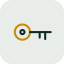

<!-- band -->

# Documentation

The guides for the Premisave auth-service. Start with the one that matches what you are doing. The [main README](../README.md) is the overview.

## I want to

| Goal | Read |
| --- | --- |
| Get it running on my machine | [SETUP.md](SETUP.md) |
| Understand how it is built | [ARCHITECTURE.md](ARCHITECTURE.md) |
| Sign people in from an app or a website | [AUTHENTICATION.md](AUTHENTICATION.md), then [API.md](API.md) |
| Add Google, Facebook or GitHub sign in | [SOCIAL_SIGN_IN.md](SOCIAL_SIGN_IN.md) |
| Find a setting | [CONFIGURATION.md](CONFIGURATION.md) |
| Create administrators or tune the alerts | [ADMIN_AND_ACCOUNT_SECURITY.md](ADMIN_AND_ACCOUNT_SECURITY.md) |
| Understand the Home Owner application | [HOME_OWNER_APPLICATIONS.md](HOME_OWNER_APPLICATIONS.md) |
| Keep application documents on a NAS | [STORAGE.md](STORAGE.md) |
| Check tokens or call the service from another service | [INTEGRATION.md](INTEGRATION.md) |
| Put it on a server | [DEPLOYMENT.md](DEPLOYMENT.md) |
| Change the code | [DEVELOPMENT.md](DEVELOPMENT.md) |
| Fix something that is not working | [TROUBLESHOOTING.md](TROUBLESHOOTING.md) |

## All guides

| Guide | What is in it |
| --- | --- |
| &nbsp;[SETUP.md](SETUP.md) | Install, configure, run, check and create the first account. |
| &nbsp;[ARCHITECTURE.md](ARCHITECTURE.md) | Layers, filters, data model, Redis, background jobs, errors. |
| &nbsp;[AUTHENTICATION.md](AUTHENTICATION.md) | Tokens, sessions, refresh rotation, devices, throttling, logout. |
| &nbsp;[SOCIAL_SIGN_IN.md](SOCIAL_SIGN_IN.md) | The three providers, the two ways to sign in, account linking. |
| &nbsp;[API.md](API.md) | Every endpoint, grouped, with who may call it. |
| &nbsp;[CONFIGURATION.md](CONFIGURATION.md) | Every setting with its default. |
| &nbsp;[ADMIN_AND_ACCOUNT_SECURITY.md](ADMIN_AND_ACCOUNT_SECURITY.md) | Administrators, alerts, risk scoring, retention. |
| &nbsp;[HOME_OWNER_APPLICATIONS.md](HOME_OWNER_APPLICATIONS.md) | The application workflow, documents, review, emails. |
| &nbsp;[STORAGE.md](STORAGE.md) | Local disk or a mounted network share for documents. |
| &nbsp;[INTEGRATION.md](INTEGRATION.md) | The token contract and the internal API. |
| &nbsp;[DEPLOYMENT.md](DEPLOYMENT.md) | Going live, proxies, containers, the known limits. |
| &nbsp;[DEVELOPMENT.md](DEVELOPMENT.md) | Commands, house rules, adding things, tests. |
| &nbsp;[TROUBLESHOOTING.md](TROUBLESHOOTING.md) | Symptoms and fixes. |

Related folders: [`../test-client`](../test-client/README.md) (a browser console for the API), [`../oauth-test`](../oauth-test/README.md) (social sign in tester), [`../postman`](../postman) (a collection) and [`assets`](assets) (the pictures, drawn by `../tool/readme_assets.py`).

## Conventions in these guides

- Examples use `http://localhost:8080` and invented values. Replace them with your own and never paste a real secret into a document, an issue or a chat.
- "Signed in" means a valid access token. "Staff" is `ADMIN`, `OPERATIONS`, `FINANCE` or `SUPPORT`.
- The documents describe what the code does. When they disagree with the code, the code is right, and the document needs a fix.
