# Setup

This guide takes you from nothing to a running auth-service you can sign in to. It should take about fifteen minutes. If something goes wrong, [TROUBLESHOOTING.md](TROUBLESHOOTING.md) lists the usual causes.



## Contents

- [What you need](#what-you-need)
- [1. Install the tools](#1-install-the-tools)
- [2. Start MongoDB and Redis](#2-start-mongodb-and-redis)
- [3. Get the code](#3-get-the-code)
- [4. Configure](#4-configure)
- [5. Run](#5-run)
- [6. Check it](#6-check-it)
- [7. Create an account](#7-create-an-account)
- [Optional extras](#optional-extras)
- [Next steps](#next-steps)

## What you need

| Tool | Why | Notes |
| --- | --- | --- |
| Java 21 (a JDK) | The service targets Java 21. | `java -version` should say 21 or newer. |
| git | To get the code. | |
| MongoDB | All accounts, sessions and applications. | The examples use MongoDB 8. Any recent version works. |
| Redis | Token blacklist, session cache, sign-in throttles. | The examples use Redis 7. |
| A Gmail account | Sends activation, reset and alert emails. | Turn on 2-step verification, then create an App Password. The normal password does not work. |
| A Cloudinary account | Stores profile pictures. | The free plan is enough. |

You do not need to install Maven. The repository ships the Maven wrapper (`mvnw`), which downloads the right version the first time.

## 1. Install the tools

Install a Java 21 JDK from your package manager or from [adoptium.net](https://adoptium.net), then check it:

```bash
java -version
```

Docker is the quickest way to run the two databases, so install it too unless you already have them. Docker is optional if MongoDB and Redis run on your machine or on a server you can reach.

## 2. Start MongoDB and Redis

With Docker:

```bash
docker run -d --name auth-mongo -p 27017:27017 mongo:8
docker run -d --name auth-redis -p 6379:6379 redis:7
```

Without Docker, install both from your package manager and start them as services. With no settings, the service connects to `mongodb://localhost:27017/premisave-auth` and to Redis on `localhost:6379`. For anything else, set `MONGODB_URI`, `REDIS_HOST` and `REDIS_PORT` in the next step.

The database is created the first time something is written to it, and the indexes are created at startup. There is nothing to import.

## 3. Get the code

```bash
git clone https://github.com/peacemakerbill/premisave_auth_service.git
cd premisave_auth_service
```

## 4. Configure

Copy the template. The service reads `.env` from the folder you start it in:

```bash
cp .env.example .env
```

Open `.env` and fill in the six values that have no default. The service refuses to start without them, on purpose, so that a forgotten secret can never fall back to something public.

| Key | How to get it |
| --- | --- |
| `JWT_SECRET` | `openssl rand -base64 32`. Treat it like a password. Every service that checks these tokens needs the same value. |
| `API_KEY` | `openssl rand -hex 32`. The wallet service calls it `INTERNAL_API_KEY` and must hold the same value. |
| `GMAIL_PASSWORD` | A 16 character App Password: Google Account, Security, 2-step verification, App passwords. |
| `CLOUDINARY_CLOUD_NAME`, `CLOUDINARY_API_KEY`, `CLOUDINARY_API_SECRET` | The Cloudinary dashboard, under Settings, API Keys. |

Then set these, because their defaults are not right for you:

| Key | Why |
| --- | --- |
| `GMAIL_USERNAME` | The address that sends the mail. It must belong to the App Password above. |
| `SUPPORT_EMAIL` | The address shown to people in emails when they need help. |
| `FRONTEND_URL` | Where the app runs. Links in emails point here. The default is `http://localhost:3000`. |
| `SECURITY_DEVICE_COOKIE_SECURE` | Set to `false` while you use plain `http` on localhost. Browsers drop a secure cookie on `http`, and every sign in then looks like a new device. |

A local file needs nothing else. [CONFIGURATION.md](CONFIGURATION.md) lists every other setting, and `.env.example` has a comment for each. Write values without quotes and without trailing spaces, and never commit `.env`. It is already in `.gitignore`.

## 5. Run

```bash
sh ./mvnw spring-boot:run
```

The first run downloads dependencies, so give it a minute. When you see `Started PremisaveAuthServiceApplication`, the service is listening on port 8080. The port is fixed in `application.yml`. To change it, edit `server.port` there.

To run a packaged jar instead:

```bash
sh ./mvnw -q -DskipTests package
java -jar target/premisave_auth_service-0.0.1-SNAPSHOT.jar
```

Start it from the folder that holds `.env`, or set the same values as real environment variables.

## 6. Check it

```bash
curl http://localhost:8080/health
# {"status":"UP","service":"auth-service","health":"PASSING","timestamp":"..."}
```

`/health` only proves the process is up. It does not test MongoDB, Redis or mail. The check that proves the databases work is creating an account.

## 7. Create an account

Register through the [Flutter app](https://github.com/peacemakerbill/premisave_flutter_frontend), through [`test-client/auth-console.html`](../test-client/README.md), or with curl:

```bash
curl -s -X POST http://localhost:8080/auth/signup \
  -H 'Content-Type: application/json' \
  -d '{
    "firstName": "Ada",
    "lastName": "Lovelace",
    "email": "you@example.com",
    "phoneNumber": "+10000000000",
    "password": "a long passphrase"
  }'
```

You get a response with a token, and an email arrives with an activation link. An account must be verified before it can sign in, so open the link. The link is built from `FRONTEND_URL` and ends in `/verify/<token>`. If you have no front end running, call the same step by hand:

```bash
curl http://localhost:8080/auth/verify/<token from the email>
```

Then sign in:

```bash
curl -s -X POST http://localhost:8080/auth/signin \
  -H 'Content-Type: application/json' \
  -d '{"email":"you@example.com","password":"a long passphrase"}'
```

A new account is always a `CLIENT`. To get the first administrator, set one of these in `.env` and restart:

- `INITIAL_ADMIN_EMAILS=you@example.com` creates the account and emails an invitation link, or promotes a verified account that already exists.
- `ADMIN1_EMAIL`, `ADMIN1_FIRST_NAME` and `ADMIN1_PASSWORD` create the account directly, already verified.

The rules, and why the invitation is the safer path, are in [ADMIN_AND_ACCOUNT_SECURITY.md](ADMIN_AND_ACCOUNT_SECURITY.md).

## Optional extras

| What | Setting | Guide |
| --- | --- | --- |
| Sign in with Google, Facebook or GitHub | `GOOGLE_CLIENT_ID`, `FACEBOOK_APP_ID` and `FACEBOOK_APP_SECRET`, `GITHUB_CLIENT_ID` and `GITHUB_CLIENT_SECRET` | [SOCIAL_SIGN_IN.md](SOCIAL_SIGN_IN.md) |
| Address search with Google Places | `GOOGLE_MAPS_API_KEY` | [CONFIGURATION.md](CONFIGURATION.md#places) |
| Home Owner application files | `STORAGE_LOCAL_PATH`, or a mounted network share | [STORAGE.md](STORAGE.md) |
| Alerts for new devices and odd sign ins | On by default. Needs working mail. | [ADMIN_AND_ACCOUNT_SECURITY.md](ADMIN_AND_ACCOUNT_SECURITY.md) |
| Where the sign in location comes from | `SECURITY_IP_GEOLOCATION_ENABLED=true` | [ADMIN_AND_ACCOUNT_SECURITY.md](ADMIN_AND_ACCOUNT_SECURITY.md#3-geolocation-proxies-and-mfa) |

## Next steps

- Point the [Flutter app](https://github.com/peacemakerbill/premisave_flutter_frontend) at `http://localhost:8080` by setting its `BASE_URL`.
- Read [AUTHENTICATION.md](AUTHENTICATION.md) to see what the tokens contain and how refresh works.
- Import [`postman/`](../postman) to try every endpoint.
- Before you put it on a server, work through [DEPLOYMENT.md](DEPLOYMENT.md).
