<!-- band -->
<div align="center">



[](#local-folder)
[](#network-share)
[](STORAGE.md)
[](https://github.com/peacemakerbill/premisave_auth_service/commits/main/docs/STORAGE.md)

</div>

# Document storage

Home Owner applications carry identity and ownership documents. They are some of the most sensitive files the platform holds, so they never go into MongoDB, never to a third party, and never behind a public link. They live on a disk you control and are served only through the application endpoints, to the applicant who owns them and to staff.

## Contents

- [How it works](#how-it-works)
- [Choosing a location](#choosing-a-location)
- [Local folder](#local-folder)
- [Network share](#network-share)
- [Changing the location from the admin dashboard](#changing-the-location-from-the-admin-dashboard)
- [Folder and file names](#folder-and-file-names)
- [What is checked](#what-is-checked)
- [When storage is not working](#when-storage-is-not-working)
- [Backups and growth](#backups-and-growth)
- [Safety rules built in](#safety-rules-built-in)




## How it works

```text
POST /home-owner/applications/{id}/documents
      validate the file by its content, size and type
      write to <storage>/<applicationNumber> <applicantName>/<TYPE>_<yyyyMMdd-HHmmss>.<ext>
      save the record in MongoDB with the storage key and the SHA-256
GET .../download
      check the caller is the owner or staff, then stream the file
```

MongoDB holds the record: type, original name, size, SHA-256, status, expiry and the storage key. The bytes are on the disk.

## Choosing a location

| `STORAGE_TYPE` | Use it when |
| --- | --- |
| `LOCAL` (default) | One server, and a disk you back up. Simple and the right start for development. |
| `NETWORK` | The files should live on a NAS, such as a Synology, so they are separate from the server and easy to back up. |

Nothing here is needed to start the service. With an unusable location it still boots, and uploads answer `503` until it is fixed, unless you set `STORAGE_FAIL_ON_UNAVAILABLE=true`, which stops startup instead.

## Local folder

```text
STORAGE_TYPE=LOCAL
STORAGE_LOCAL_PATH=/var/lib/premisave/homeowner-onboarding
```

- The path must be absolute, or start with `~/`. It must not be `/` or a system folder such as `/etc` or `/var`.
- Leave it empty and the files go to `~/premisave-file-storage/homeowner-onboarding` in the home folder of the user who runs the service.
- The folder is created when it is missing (`STORAGE_CREATE_DIRECTORIES=true`). The service user needs read and write access.

## Network share

The operating system mounts the share. The service only writes into the mounted folder. That keeps the NAS username and password out of this application completely, since they belong to the mount.

```text
STORAGE_TYPE=NETWORK
STORAGE_NETWORK_PROTOCOL=SMB
STORAGE_NETWORK_HOST=192.168.1.50
STORAGE_NETWORK_SHARE=premisave
STORAGE_NETWORK_MOUNT_PATH=/mnt/premisave-nas
STORAGE_NETWORK_DIRECTORY=homeowner-onboarding
STORAGE_NETWORK_REQUIRE_MOUNT=true
```

**Mount an SMB share** (Linux). Keep the login in a file only root can read:

```bash
sudo apt install cifs-utils
sudo mkdir -p /mnt/premisave-nas
sudo install -m 600 /dev/null /etc/premisave-nas.cred
sudoedit /etc/premisave-nas.cred        # username=... and password=... on two lines
```

Add one line to `/etc/fstab`, using the user id and group id of the account that runs the service (`id premisave`):

```text
//192.168.1.50/premisave  /mnt/premisave-nas  cifs  credentials=/etc/premisave-nas.cred,uid=1001,gid=1001,file_mode=0640,dir_mode=0750,_netdev,nofail  0  0
```

```bash
sudo mount -a
```

**Mount an NFS export** instead, with `STORAGE_NETWORK_PROTOCOL=NFS` and `STORAGE_NETWORK_SHARE=/volume1/premisave`:

```text
192.168.1.50:/volume1/premisave  /mnt/premisave-nas  nfs  defaults,_netdev,nofail  0  0
```

`STORAGE_NETWORK_HOST` and `STORAGE_NETWORK_SHARE` are used to describe the share in the log and to check it. They are never used to connect.

**Why `STORAGE_NETWORK_REQUIRE_MOUNT=true` matters.** If the share fails to mount after a reboot, `/mnt/premisave-nas` is still an ordinary empty folder on the local disk. Without this check, uploads would quietly fill the server's own disk and the files would appear to vanish when the share returns. With it on, the service compares the folder's file system with its parent's, and refuses to write unless a different file system is mounted there.

`STORAGE_NETWORK_DIRECTORY` must be a relative folder name with no `..` and only letters, digits, spaces and `. _ ( ) -`.

## Changing the location from the admin dashboard

The `.env` values above are the starting point. An administrator can also choose the location from the apps (Flutter app: Settings, then Storage, for administrators) or by calling `/admin/storage-settings`. The choice is saved in this service's own MongoDB (collection `storage_settings`).

- **The dashboard wins once saved.** From then on the saved values are used. **Reset to .env** deletes them and the `.env` values apply again.
- **What can be set:** the type (`LOCAL` or `NETWORK`), the local folder, and for a share the protocol, host, share, mount path, folder inside it and the "refuse unless really mounted" check, plus the free space limit.
- **Only inside allowed roots.** Folders must be inside `STORAGE_ALLOWED_ROOTS` (full paths separated by commas, `~` allowed). Blank allows only `STORAGE_LOCAL_PATH` and `STORAGE_NETWORK_MOUNT_PATH`. To pick a share from the dashboard, list the folder it is mounted in, for example `/mnt`. `..` and symbolic links that lead out of the roots are refused, and nothing is created outside them.
- **The folder picker shows only the allowed roots.** The app's folder button starts at the list of allowed roots and lets an administrator open folders inside them, go up (never above a root) and add a new folder. A folder that is not inside a root is not shown and cannot be typed in either. If the picker offers too little, widen `STORAGE_ALLOWED_ROOTS` in `.env` and restart the service. For development, `STORAGE_ALLOWED_ROOTS=~/MyProjects/file-storage,/mnt` allows the folder next to the default one and any share mounted under `/mnt`. List the narrowest folders that do the job: everything inside a listed folder is open to administrators, so never list `/` or a whole home folder.
- **Try before saving.** "Try it" creates the folder, writes and deletes a small file, checks that a share is really mounted and that the free space is above the limit. A save does the same and is refused when it fails, so a bad value can never be saved.
- **Old files keep working.** Each folder used before is remembered (the last 20), and the `.env` folder too. Downloads look in the current folder first and then in those, and deleting an application removes it from all of them. An application that was started in an old folder carries on in a new folder of the same name in the new location. Nothing is copied or moved.
- **A saved location that is no longer inside the allowed roots is ignored** with a warning in the log, and the `.env` values are used, so editing `STORAGE_ALLOWED_ROOTS` can never leave the service writing somewhere it should not.
- **Audit trail.** Each save and reset is written as `STORAGE_SETTINGS_CHANGED` with the administrator's name (`GET /admin/security/events`).
- **Docker.** The service sees only what is mounted into the container (`/data` in the compose files). To offer another folder, add a volume for it and list its container path in `STORAGE_ALLOWED_ROOTS`.
- **Several copies of the service** share the saved values through MongoDB, so every copy needs the same folder or share mounted at the same path.

| Method | Endpoint | Purpose |
| --- | --- | --- |
| `GET` | `/admin/storage-settings` | Allowed roots and the storage in use: where it comes from (`ENV` or `DASHBOARD`), the values, the folder, whether it is ready and why not, the free space, and the `.env` values |
| `POST` | `/admin/storage-settings/check` | Try values without saving: `{ type, localPath, networkProtocol, networkHost, networkShare, networkMountPath, networkDirectory, networkRequireMount, minFreeMb }`. Returns `{ ok, problem, location, freeMb }` |
| `PUT` | `/admin/storage-settings` | Save them (same body). `400` with the reason when refused |
| `DELETE` | `/admin/storage-settings` | Reset to the `.env` values |
| `GET` | `/admin/storage-settings/browse?path=` | The folder picker: the folders inside `path`, or the allowed roots when `path` is left out. Returns `{ path, parent, top, exists, canCreate, writable, freeMb, truncated, folders: [{ name, path }] }` |
| `POST` | `/admin/storage-settings/folders` | Make a folder: `{ parent, name }`. Returns the new folder in the same shape |

## Folder and file names

- Each application gets one folder: `<application number> <applicant name>`, for example `HOA-2026-000123 Ada Lovelace`. A person can find a file by looking in the folder, with no database.
- Each file is `<DOCUMENT_TYPE>_<yyyyMMdd-HHmmss>.<ext>`, for example `TITLE_DEED_20260115-093012.pdf`. The extension comes from the detected content, never from the client's file name.
- Names are cleaned into safe characters. A clash gets a short random suffix. An existing file is never overwritten.
- The applicant's original file name is kept in the database for display only.

## What is checked

| Check | Result |
| --- | --- |
| The file is empty | `400` |
| The content is not a PDF, JPEG, PNG or WEBP (read from the first bytes) | `400` |
| The file is over `HOME_OWNER_MAX_FILE_SIZE_MB` | `400` |
| The same SHA-256 is already on the application | `409` |
| The application is at `HOME_OWNER_MAX_DOCUMENTS` | `409` |
| The free space is below `STORAGE_MIN_FREE_MB` | `503` |
| The location is missing, read only, or not mounted | `503` |

Note that the server's own upload ceiling is 10 MB, so raising `HOME_OWNER_MAX_FILE_SIZE_MB` above 10 does nothing until `spring.servlet.multipart.max-file-size` in `application.yml` is raised too.

## When storage is not working

The log says why, in plain words and with no secret, at startup (`StorageStartupCheck`) and again on each failed operation. The caller gets `503` with a general message.

| Symptom | Likely cause |
| --- | --- |
| `STORAGE_LOCAL_PATH is empty` | `STORAGE_TYPE=LOCAL` with a blank path. Set it, or leave `STORAGE_TYPE` out for the home folder default. |
| `must be an absolute path` | A relative path. Use `/...` or `~/...`. |
| `must not point at the root or a system directory` | The path is `/`, `/etc`, `/var` and so on. Pick a folder of your own. |
| Not writable | The service user does not own the folder. `chown` it, or change `uid`/`gid` on the mount. |
| Not mounted | `NETWORK` with `REQUIRE_MOUNT=true` and nothing mounted. Run `mount -a`, then check `findmnt /mnt/premisave-nas`. |
| Low disk space | Free space is under `STORAGE_MIN_FREE_MB`. |

The check result is cached for a few seconds, so a fix takes effect within moments and needs no restart.

## Backups and growth

- Back up the **storage folder and MongoDB together**. A record without its file, or a file without its record, is a broken application.
- A document removed by an applicant is deleted from disk, and deleting an unsent draft removes its whole folder. Files of withdrawn or rejected applications stay until you remove them. Decide a retention rule that fits the law where you operate, because these are identity documents.
- A typical application is a few documents of 1 to 5 MB. Plan disk space from the number of applicants you expect, and watch the free space, because uploads stop at `STORAGE_MIN_FREE_MB`.

## Safety rules built in

- Every path is resolved inside the storage folder. A name that tries `..`, an absolute path or a symbolic link out of the folder is refused.
- Symbolic links are never followed when reading, writing or deleting.
- A file is written to a temporary name and moved into place, so a half written file never appears.
- Files are given the permissions `rw-r-----` where the file system supports them.
- If the database save fails after a file was written, the file is deleted again. Old files are removed only after the new record is safely saved.
- The disk path and the per file storage key are never included in an API response, except in the administrators' own storage endpoint (`/admin/storage-settings`), which shows the folder in use. Staff see only the application's folder name, so they can find it on the share.
- Only the applicant and staff can download. Anyone else gets `404`.
